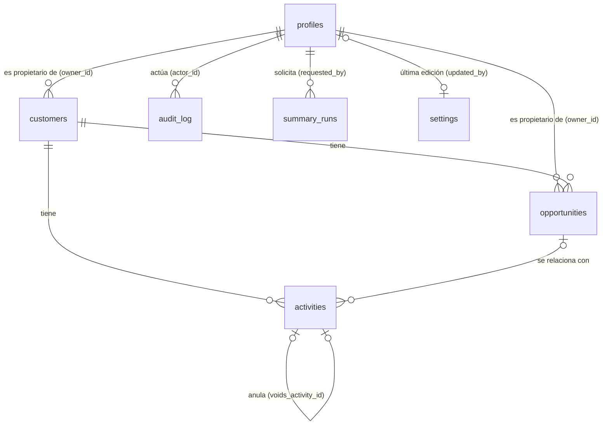

# SCRIPTS-SQL.md — Estructura oficial de la base de datos de CRM-123

**Versión 1.0 · 22-nov-2026 · Fuente única de verdad del almacén de datos.**

Este documento contiene la estructura **oficial** de la base de datos y todos los scripts para construirla y verificarla. Lo usan tres consumidores, y ninguno puede modificarla:

| Consumidor | Cómo lo usa |
|---|---|
| **Claude.ai Chat** (con el conector MCP de Supabase) | Crea toda la estructura, ejecuta la verificación y las pruebas, y reporta resultados (Hito 1). |
| **Claude Design** | Usa el modelo (secciones 2 y 3) como referencia: solo existen los campos y valores aquí descritos. |
| **Claude Code Web** | Usa la estructura como contrato estricto: nombres de tablas, columnas, valores permitidos y reglas. |

> **Regla de cambios.** Nadie altera tablas, columnas, políticas, vistas ni funciones por su cuenta. Si algo no encaja, se detiene el trabajo, se informa al humano y esta versión del documento se reemplaza por una nueva y completa. Los scripts de este documento fueron ejecutados con éxito en un Postgres local que simula Supabase: 17 comprobaciones estructurales, 53 pruebas de integridad y 43 pruebas de seguridad por fila, todas correctas. Su primera ejecución real en Supabase es el Hito 1.

---

## 1. Ficha del almacén de datos

| Elemento | Valor |
|---|---|
| Marca | CRM-123 |
| Organización de Supabase | **Org CRM 123** |
| Proyecto de Supabase | **dbcrm123** (región UE — Frankfurt, `eu-central-1`; plan gratuito) |
| Base de datos Postgres interna | `postgres` (Supabase no permite renombrarla; `dbcrm123` es el nombre del **proyecto**) |
| Esquema de la aplicación | `public` |
| Acceso de usuarios | Supabase Auth con **correo electrónico + contraseña**. El correo es el "usuario". Registro público **desactivado**. |
| País, moneda, zona horaria | España · euro (EUR) · `Europe/Madrid` |
| Identificadores personales | **Prohibidos.** No existe ninguna columna de DNI, NIE, NIF, DPI, NIT ni pasaporte. El teléfono identifica al cliente. |
| Borrado | **No existe el borrado físico.** Solo archivado lógico (`archived_at`) y desactivación de usuarios (`is_active`). |

---

## 2. Modelo de datos

### 2.1 Diagrama de relaciones



Siete tablas, cuatro vistas. Toda llave foránea es `ON DELETE RESTRICT` (o equivalente): ningún dato desaparece en cascada.

### 2.2 Tablas y columnas

Convenciones: nombres en inglés `snake_case`; **valores guardados en español sin tildes** (se muestran con su etiqueta en la sección 2.3). Fechas y horas: `timestamptz` en UTC; `date` para fechas de calendario (cierre, próxima acción).

#### `profiles` — usuarios del CRM
Una fila por persona con acceso. Máximo **10 vendedores activos y 2 supervisores activos**.

| Columna | Tipo | Nulo | Defecto | Regla |
|---|---|---|---|---|
| `id` | uuid PK | no | — | Igual al id del usuario en Supabase Auth. Inmutable. |
| `full_name` | text | no | — | 2–120 caracteres. |
| `email` | text | no | — | Minúsculas, formato válido, único. Es el usuario de ingreso y el destino del resumen matutino. |
| `role` | text | no | — | `vendedor` o `supervisor`. |
| `is_active` | boolean | no | `true` | `false` = usuario desactivado (pierde todo acceso). |
| `must_change_password` | boolean | no | `true` | `true` fuerza el cambio de contraseña temporal en el primer ingreso. |
| `created_at`, `updated_at` | timestamptz | no | `now()` | `updated_at` se actualiza automáticamente. |

#### `settings` — configuración (una sola fila, `id = 1`)

| Columna | Tipo | Nulo | Defecto | Regla |
|---|---|---|---|---|
| `id` | smallint PK | no | `1` | Siempre 1. |
| `morning_summary_enabled` | boolean | no | `true` | Interruptor "Resumen matutino activo". |
| `timezone` | text | no | `Europe/Madrid` | Debe ser una zona horaria válida. |
| `currency` | char(3) | no | `EUR` | Solo `EUR`. |
| `manual_send_min_interval_minutes` | integer | no | `10` | Entre 1 y 1440. Intervalo mínimo entre envíos manuales. |
| `updated_by`, `updated_at` | uuid → profiles, timestamptz | sí / no | — | Se sellan automáticamente. |

> La hora del envío automático (7:30, lunes a viernes) **no** se guarda aquí: vive en el flujo de n8n (WF-CRM123).

#### `customers` — clientes (personas)

| Columna | Tipo | Nulo | Defecto | Regla |
|---|---|---|---|---|
| `id` | uuid PK | no | `gen_random_uuid()` | |
| `owner_id` | uuid → profiles | no | — | Vendedor propietario. Debe ser un **vendedor activo**. |
| `first_name` | text | no | — | 1–80 caracteres. |
| `last_name` | text | no | — | 1–120 caracteres. |
| `phone` | text | no | — | **Identificador del cliente.** Formato internacional `+` seguido de 8 a 15 dígitos (ej. `+34600111222`). **Único** en toda la tabla, incluidos archivados. |
| `email` | text | sí | — | Opcional; minúsculas; formato válido. |
| `notes` | text | sí | — | Hasta 2000 caracteres. |
| `source` | text | no | — | `tienda`, `web`, `redes`, `recomendacion`. |
| `accepts_communications` | boolean | no | `false` | Consentimiento para recibir comunicaciones (RGPD). |
| `archived_at` | timestamptz | sí | — | No nulo = archivado. |
| `created_by` | uuid → profiles | no | `auth.uid()` | Inmutable. |
| `created_at`, `updated_at` | timestamptz | no | `now()` | |

#### `opportunities` — oportunidades de venta

| Columna | Tipo | Nulo | Defecto | Regla |
|---|---|---|---|---|
| `id` | uuid PK | no | `gen_random_uuid()` | |
| `customer_id` | uuid → customers | no | — | Inmutable. No se crean oportunidades para clientes archivados. |
| `owner_id` | uuid → profiles | no | — | **Siempre igual al propietario del cliente** (se sincroniza al reasignar). |
| `title` | text | no | — | 2–120 caracteres. |
| `type` | text | no | — | `evento_privado`, `catering`, `club_lectura_suscripcion`, `pedido_grande_libros`, `venta_grupos`. |
| `stage` | text | no | `nueva` | `nueva`, `contactada`, `propuesta_enviada`, `negociacion`, `ganada`, `perdida`. |
| `estimated_amount` | numeric(12,2) | no | `0` | Euros, ≥ 0. |
| `final_amount` | numeric(12,2) | sí | — | Obligatorio **solo** si `stage = ganada`; nulo en cualquier otra etapa. |
| `closed_on` | date | sí | — | Obligatorio si `ganada` o `perdida`; nulo si está abierta. |
| `lost_reason` | text | sí | — | Obligatorio **solo** si `stage = perdida`: `precio`, `sin_respuesta`, `eligio_otra_opcion`, `ya_no_le_interesa`, `otro`. |
| `next_action_date` | date | sí | — | Próxima acción. Va siempre junto con `next_action_text` (ambos o ninguno). |
| `next_action_text` | text | sí | — | 1–200 caracteres. Una oportunidad cerrada no tiene próxima acción. |
| `notes` | text | sí | — | Hasta 2000 caracteres. |
| `archived_at` | timestamptz | sí | — | No nulo = archivada. |
| `created_by`, `created_at`, `updated_at` | — | no | `auth.uid()`, `now()` | |

#### `activities` — historial de actividades (**solo inserción**)
Nadie puede editar ni borrar una actividad. Un error se corrige con una nota nueva o con una **anulación**.

| Columna | Tipo | Nulo | Defecto | Regla |
|---|---|---|---|---|
| `id` | uuid PK | no | `gen_random_uuid()` | |
| `customer_id` | uuid → customers | no | — | |
| `opportunity_id` | uuid → opportunities | sí | — | Si se indica, debe ser del mismo cliente. |
| `type` | text | no | — | `llamada`, `mensaje`, `reunion`, `nota`, `anulacion`. |
| `description` | text | no | — | 1–2000 caracteres. |
| `occurred_at` | timestamptz | no | `now()` | Cuándo ocurrió. |
| `voids_activity_id` | uuid → activities | sí | — | Obligatorio **solo** si `type = anulacion`. Una actividad se anula una sola vez; no se anula una anulación; el vendedor solo anula las suyas. |
| `created_by` | uuid → profiles | no | `auth.uid()` | Autor. |
| `created_at` | timestamptz | no | `now()` | |

#### `audit_log` — auditoría (**solo inserción**)

| Columna | Tipo | Nulo | Regla |
|---|---|---|---|
| `id` | bigint identity PK | no | |
| `actor_id` | uuid → profiles | sí | Nulo cuando actúa el sistema (clave de servicio). |
| `actor_role` | text | sí | Rol del actor al momento del evento. |
| `action` | text | no | Ver acciones registradas abajo. |
| `entity_type` | text | no | `customer`, `opportunity`, `profile`, `settings`, `summary_run`. |
| `entity_id` | uuid | sí | |
| `details` | jsonb | no | Datos del evento (`{}` por defecto). |
| `created_at` | timestamptz | no | |

Acciones que registra automáticamente la base: `cliente_creado`, `cliente_reasignado`, `cliente_archivado`, `cliente_recuperado`, `oportunidad_creada`, `oportunidad_etapa`, `oportunidad_reasignada`, `oportunidad_archivada`, `oportunidad_recuperada`, `usuario_creado`, `usuario_rol_cambiado`, `usuario_desactivado`, `usuario_activado`, `ajuste_actualizado`. La aplicación registra además `resumen_manual_solicitado` y `resumen_finalizado` (entidad `summary_run`).

#### `summary_runs` — ejecuciones del resumen matutino

| Columna | Tipo | Nulo | Defecto | Regla |
|---|---|---|---|---|
| `id` | uuid PK | no | `gen_random_uuid()` | |
| `trigger_type` | text | no | — | `automatico` o `manual`. |
| `requested_by` | uuid → profiles | sí | — | Obligatorio si es `manual`. |
| `status` | text | no | `en_curso` | `en_curso`, `correcto`, `con_errores`, `fallido`. **Solo una ejecución `en_curso` a la vez.** |
| `recipients_total`, `recipients_sent` | integer | no | `0` | `enviados ≤ total`. |
| `error_detail` | text | sí | — | |
| `started_at` | timestamptz | no | `now()` | |
| `finished_at` | timestamptz | sí | — | Nulo si y solo si está `en_curso`. |

Esta tabla la escribe **únicamente el servidor** con la clave de servicio; los usuarios (solo supervisores) la leen.

### 2.3 Valores permitidos y su etiqueta en pantalla

| Campo | Valor guardado → Etiqueta |
|---|---|
| `role` | `vendedor` → Vendedor · `supervisor` → Supervisor |
| `source` | `tienda` → Tienda · `web` → Web · `redes` → Redes sociales · `recomendacion` → Recomendación |
| `opportunities.type` | `evento_privado` → Evento privado · `catering` → Catering · `club_lectura_suscripcion` → Club de lectura o suscripción · `pedido_grande_libros` → Pedido grande de libros · `venta_grupos` → Venta a grupos |
| `stage` | `nueva` → Nueva · `contactada` → Contactada · `propuesta_enviada` → Propuesta enviada · `negociacion` → Negociación · `ganada` → Ganada · `perdida` → Perdida |
| `lost_reason` | `precio` → Precio · `sin_respuesta` → Sin respuesta · `eligio_otra_opcion` → Eligió otra opción · `ya_no_le_interesa` → Ya no le interesa · `otro` → Otro |
| `activities.type` | `llamada` → Llamada · `mensaje` → Mensaje · `reunion` → Reunión o visita · `nota` → Nota · `anulacion` → Anulada *(entrada del sistema; no se ofrece al crear)* |
| `summary_runs.status` | `en_curso` → En curso · `correcto` → Correcto · `con_errores` → Con errores · `fallido` → Fallido |
| `summary_runs.trigger_type` | `automatico` → Automático · `manual` → Manual |

### 2.4 Vistas (todas con `security_invoker = true`)

| Vista | Contenido | Quién ve qué |
|---|---|---|
| `v_next_actions` | Oportunidades abiertas con próxima acción: `opportunity_id`, `owner_id`, `owner_name`, `customer_id`, `customer_name`, `customer_phone`, `title`, `type`, `stage`, `estimated_amount`, `next_action_date`, `next_action_text`, `is_overdue`. Excluye archivadas. El tablero del día filtra `next_action_date <= hoy`. | Vendedor: lo suyo. Supervisor: todo. |
| `v_pipeline_summary` | `owner_id`, `stage`, `opportunities_count`, `estimated_total` (euros), no archivadas. | Ídem. |
| `v_team_summary` | Una fila por **vendedor activo**: `owner_id`, `owner_name`, `open_count`, `open_estimated_total`, `won_month_count`, `won_month_total` (suma de `final_amount`), `lost_month_count`, `overdue_actions_count`. "Mes" = mes en curso en la zona horaria de `settings`. | Vendedor: su fila. Supervisor: todas. |
| `v_lost_reasons_month` | `owner_id`, `lost_reason`, `lost_count` del mes en curso. | Ídem. |

### 2.5 Funciones disponibles para la aplicación

| Función | Uso |
|---|---|
| `app_role()` | Devuelve `vendedor` / `supervisor` del usuario activo según `profiles` (nulo si está desactivado). |
| `is_supervisor()`, `is_seller()` | Booleanos derivados de `app_role()`. |
| `app_today()` | Fecha de hoy en la zona horaria de `settings`. |
| `mark_password_changed()` | El usuario marca su propio `must_change_password = false`. |

Las demás funciones son internas (triggers y auditoría) y no son invocables por la API.

---

## 3. Seguridad por fila: quién puede hacer qué

Todas las tablas tienen RLS activa. Ninguna tiene política `DELETE`. Leyenda: **P** = solo filas propias · **T** = todas · **—** = sin acceso · **S** = solo con la clave de servicio del servidor.

| Tabla | Vendedor | Supervisor |
|---|---|---|
| `profiles` | Leer: su propio perfil (P). Actualizar: — | Leer: T. Actualizar: T. Crear: S |
| `settings` | Leer: sí (única política con `true`). Actualizar: — | Leer y actualizar |
| `customers` | Leer / crear / actualizar: P (incluye archivar y recuperar). No puede cambiar `owner_id` | T (incluye reasignar) |
| `opportunities` | Leer / crear / actualizar: P | T |
| `activities` | Leer: de sus clientes. Insertar: en sus clientes, como autor. Nada más | Leer T. Insertar. Nada más |
| `audit_log` | — | Leer T. Insertar solo con su propia identidad. Nada más |
| `summary_runs` | — | Leer. Escribir: S |
| Vistas | Solo lo suyo | Todo |

Un vendedor **desactivado** no ve nada. El rol se lee siempre de `profiles`, nunca de un JWT.

**Nota técnica sobre `WITH CHECK`.** En Postgres, si una política `UPDATE` no declara `WITH CHECK`, se usa su `USING`, y además la fila nueva debe pasar la política `SELECT`. Por eso un vendedor no podría regalar un cliente aunque `WITH CHECK` fuera laxo. Aun así, la regla del proyecto es **declararlo siempre de forma explícita**, y la comprobación V05 lo verifica.

---

## 4. Reglas de negocio que la base garantiza

1. Teléfono único, en formato internacional; sin identificadores personales.
2. Máximo 10 vendedores activos y 2 supervisores activos; siempre al menos 1 supervisor activo.
3. Un cliente pertenece a un solo vendedor activo; sus oportunidades siempre tienen el mismo propietario (la reasignación las mueve juntas).
4. Una oportunidad Ganada exige monto final y fecha de cierre; una Perdida exige motivo y fecha de cierre; una abierta no tiene ninguno de los tres; una cerrada no tiene próxima acción.
5. Una oportunidad no cambia de cliente ni se crea sobre un cliente archivado.
6. Las actividades y la auditoría no se pueden editar, borrar ni vaciar, ni siquiera con la clave de servicio (triggers de bloqueo).
7. Solo una ejecución del resumen puede estar "en curso" a la vez.
8. Cambios de propietario, archivados, etapas, usuarios y ajustes quedan en `audit_log` automáticamente.

---

## 5. Orden de ejecución

| Orden | Script | Qué hace |
|---|---|---|
| 1 | `01_tables.sql` | Tablas, restricciones e índices |
| 2 | `02_functions_triggers.sql` | Funciones, reglas de integridad y auditoría |
| 3 | `03_rls_policies.sql` | RLS y políticas |
| 4 | `04_views.sql` | Vistas |
| 5 | `05_grants.sql` | Privilegios mínimos |
| 6 | `06_seed_settings.sql` | Fila única de configuración |
| 7 | `07_bootstrap_profiles_TEMPLATE.sql` | **Manual y posterior a la verificación**: crea el primer supervisor y vendedores de prueba |
| V | `V01_verificacion_estructura.sql` | Verificación de solo lectura (17 comprobaciones) |
| T | `T01_pruebas_integridad.sql`, `T02_pruebas_seguridad_rls.sql` | Pruebas funcionales que no dejan datos |

Con el MCP de Supabase, los scripts 01–06 se aplican con `apply_migration` (un nombre por script, en este orden). V01, T01 y T02 se ejecutan con `execute_sql`, **cada archivo completo en una sola llamada**.

**Antes de los scripts 07 y de cualquier dato real**, ejecutar V01, T01 y T02. Las pruebas T01 y T02 crean sus propios usuarios y datos de prueba dentro de una transacción y la revierten al final; no contaminan la base.

---

## 6. Scripts de construcción

### 6.1 `01_tables.sql`
```sql
-- ============================================================
-- 01_tables.sql  |  CRM-123  |  Base de datos: dbcrm123
-- Tablas, restricciones de integridad e índices.
-- Ejecutar primero. No contiene datos.
-- ============================================================

-- ---------- profiles: usuarios del CRM (1 fila por usuario de Supabase Auth) ----------
create table public.profiles (
  id                   uuid primary key references auth.users (id) on delete restrict,
  full_name            text        not null,
  email                text        not null,
  role                 text        not null,
  is_active            boolean     not null default true,
  must_change_password boolean     not null default true,
  created_at           timestamptz not null default now(),
  updated_at           timestamptz not null default now(),
  constraint profiles_full_name_len  check (char_length(btrim(full_name)) between 2 and 120),
  constraint profiles_email_format   check (email = lower(email) and email ~ '^[^@\s]+@[^@\s]+\.[^@\s]+$'),
  constraint profiles_role_values    check (role in ('vendedor', 'supervisor'))
);
create unique index profiles_email_key on public.profiles (email);

-- ---------- settings: configuración (una sola fila, id = 1) ----------
create table public.settings (
  id                               smallint    primary key default 1,
  morning_summary_enabled          boolean     not null default true,
  timezone                         text        not null default 'Europe/Madrid',
  currency                         char(3)     not null default 'EUR',
  manual_send_min_interval_minutes integer     not null default 10,
  updated_by                       uuid        references public.profiles (id) on delete restrict,
  updated_at                       timestamptz not null default now(),
  constraint settings_single_row     check (id = 1),
  constraint settings_currency_eur   check (currency = 'EUR'),
  constraint settings_interval_range check (manual_send_min_interval_minutes between 1 and 1440)
);

-- ---------- customers: clientes (personas). El teléfono es el identificador ----------
create table public.customers (
  id                     uuid        primary key default gen_random_uuid(),
  owner_id               uuid        not null references public.profiles (id) on delete restrict,
  first_name             text        not null,
  last_name              text        not null,
  phone                  text        not null,
  email                  text,
  notes                  text,
  source                 text        not null,
  accepts_communications boolean     not null default false,
  archived_at            timestamptz,
  created_by             uuid        not null default auth.uid() references public.profiles (id) on delete restrict,
  created_at             timestamptz not null default now(),
  updated_at             timestamptz not null default now(),
  constraint customers_first_name_len check (char_length(btrim(first_name)) between 1 and 80),
  constraint customers_last_name_len  check (char_length(btrim(last_name)) between 1 and 120),
  constraint customers_phone_e164     check (phone ~ '^\+[1-9][0-9]{7,14}$'),
  constraint customers_email_format   check (email is null or (email = lower(email) and email ~ '^[^@\s]+@[^@\s]+\.[^@\s]+$')),
  constraint customers_notes_len      check (notes is null or char_length(notes) <= 2000),
  constraint customers_source_values  check (source in ('tienda', 'web', 'redes', 'recomendacion'))
);
create unique index customers_phone_key        on public.customers (phone);
create index        customers_owner_idx        on public.customers (owner_id) where archived_at is null;
create index        customers_archived_idx     on public.customers (archived_at) where archived_at is not null;
create index        customers_last_name_idx    on public.customers (lower(last_name), lower(first_name));
create index        customers_created_by_idx   on public.customers (created_by);

-- ---------- opportunities: oportunidades de venta ----------
create table public.opportunities (
  id               uuid          primary key default gen_random_uuid(),
  customer_id      uuid          not null references public.customers (id) on delete restrict,
  owner_id         uuid          not null references public.profiles (id) on delete restrict,
  title            text          not null,
  type             text          not null,
  stage            text          not null default 'nueva',
  estimated_amount numeric(12,2) not null default 0,
  final_amount     numeric(12,2),
  closed_on        date,
  lost_reason      text,
  next_action_date date,
  next_action_text text,
  notes            text,
  archived_at      timestamptz,
  created_by       uuid          not null default auth.uid() references public.profiles (id) on delete restrict,
  created_at       timestamptz   not null default now(),
  updated_at       timestamptz   not null default now(),
  constraint opportunities_title_len        check (char_length(btrim(title)) between 2 and 120),
  constraint opportunities_type_values      check (type in ('evento_privado', 'catering', 'club_lectura_suscripcion', 'pedido_grande_libros', 'venta_grupos')),
  constraint opportunities_stage_values     check (stage in ('nueva', 'contactada', 'propuesta_enviada', 'negociacion', 'ganada', 'perdida')),
  constraint opportunities_estimated_nonneg check (estimated_amount >= 0),
  constraint opportunities_final_nonneg     check (final_amount is null or final_amount >= 0),
  constraint opportunities_lost_reason_values check (lost_reason is null or lost_reason in ('precio', 'sin_respuesta', 'eligio_otra_opcion', 'ya_no_le_interesa', 'otro')),
  constraint opportunities_next_text_len    check (next_action_text is null or char_length(btrim(next_action_text)) between 1 and 200),
  constraint opportunities_notes_len        check (notes is null or char_length(notes) <= 2000),
  constraint opportunities_won_fields       check (stage <> 'ganada'  or (final_amount is not null and closed_on is not null and lost_reason is null)),
  constraint opportunities_lost_fields      check (stage <> 'perdida' or (lost_reason is not null and closed_on is not null and final_amount is null)),
  constraint opportunities_open_fields      check (stage in ('ganada', 'perdida') or (final_amount is null and closed_on is null and lost_reason is null)),
  constraint opportunities_next_action_pair check ((next_action_date is null) = (next_action_text is null)),
  constraint opportunities_closed_no_next   check (stage not in ('ganada', 'perdida') or next_action_date is null)
);
create index opportunities_owner_stage_idx on public.opportunities (owner_id, stage) where archived_at is null;
create index opportunities_customer_idx    on public.opportunities (customer_id);
create index opportunities_next_action_idx on public.opportunities (next_action_date) where next_action_date is not null and archived_at is null;
create index opportunities_closed_on_idx   on public.opportunities (closed_on) where closed_on is not null;
create index opportunities_created_by_idx  on public.opportunities (created_by);

-- ---------- activities: historial de actividades (SOLO INSERCIÓN) ----------
create table public.activities (
  id                uuid        primary key default gen_random_uuid(),
  customer_id       uuid        not null references public.customers (id) on delete restrict,
  opportunity_id    uuid        references public.opportunities (id) on delete restrict,
  type              text        not null,
  description       text        not null,
  occurred_at       timestamptz not null default now(),
  voids_activity_id uuid        references public.activities (id) on delete restrict,
  created_by        uuid        not null default auth.uid() references public.profiles (id) on delete restrict,
  created_at        timestamptz not null default now(),
  constraint activities_type_values  check (type in ('llamada', 'mensaje', 'reunion', 'nota', 'anulacion')),
  constraint activities_desc_len     check (char_length(btrim(description)) between 1 and 2000),
  constraint activities_void_pair    check ((type = 'anulacion') = (voids_activity_id is not null))
);
create index        activities_customer_idx   on public.activities (customer_id, occurred_at desc);
create index        activities_opportunity_idx on public.activities (opportunity_id) where opportunity_id is not null;
create index        activities_created_by_idx on public.activities (created_by);
create unique index activities_void_once_key  on public.activities (voids_activity_id) where voids_activity_id is not null;

-- ---------- audit_log: auditoría (SOLO INSERCIÓN) ----------
create table public.audit_log (
  id          bigint      generated always as identity primary key,
  actor_id    uuid        references public.profiles (id) on delete restrict,
  actor_role  text,
  action      text        not null,
  entity_type text        not null,
  entity_id   uuid,
  details     jsonb       not null default '{}'::jsonb,
  created_at  timestamptz not null default now(),
  constraint audit_log_action_len check (char_length(action) between 1 and 80),
  constraint audit_log_entity_len check (char_length(entity_type) between 1 and 40)
);
create index audit_log_created_idx on public.audit_log (created_at desc);
create index audit_log_entity_idx  on public.audit_log (entity_type, entity_id);
create index audit_log_actor_idx   on public.audit_log (actor_id) where actor_id is not null;

-- ---------- summary_runs: ejecuciones del resumen matutino ----------
create table public.summary_runs (
  id               uuid        primary key default gen_random_uuid(),
  trigger_type     text        not null,
  requested_by     uuid        references public.profiles (id) on delete restrict,
  status           text        not null default 'en_curso',
  recipients_total integer     not null default 0,
  recipients_sent  integer     not null default 0,
  error_detail     text,
  started_at       timestamptz not null default now(),
  finished_at      timestamptz,
  constraint summary_runs_trigger_values check (trigger_type in ('automatico', 'manual')),
  constraint summary_runs_status_values  check (status in ('en_curso', 'correcto', 'con_errores', 'fallido')),
  constraint summary_runs_counts         check (recipients_total >= 0 and recipients_sent >= 0 and recipients_sent <= recipients_total),
  constraint summary_runs_finished_pair  check ((status = 'en_curso') = (finished_at is null)),
  constraint summary_runs_manual_actor   check (trigger_type <> 'manual' or requested_by is not null)
);
create index        summary_runs_started_idx     on public.summary_runs (started_at desc);
create index        summary_runs_requested_idx   on public.summary_runs (requested_by) where requested_by is not null;
create unique index summary_runs_single_running  on public.summary_runs ((true)) where status = 'en_curso';
```

### 6.2 `02_functions_triggers.sql`
```sql
-- ============================================================
-- 02_functions_triggers.sql  |  CRM-123
-- Funciones auxiliares, reglas de integridad (triggers) y auditoría.
-- Toda función SECURITY DEFINER fija search_path = public.
-- ============================================================

-- ---------- Ayudantes de rol (el rol SIEMPRE sale de la tabla profiles) ----------
create or replace function public.app_role()
returns text language sql stable security definer set search_path = public as $$
  select p.role from public.profiles p where p.id = auth.uid() and p.is_active
$$;

create or replace function public.is_supervisor()
returns boolean language sql stable security definer set search_path = public as $$
  select coalesce(public.app_role() = 'supervisor', false)
$$;

create or replace function public.is_seller()
returns boolean language sql stable security definer set search_path = public as $$
  select coalesce(public.app_role() = 'vendedor', false)
$$;

-- Fecha de hoy según la zona horaria de settings (por defecto Europe/Madrid)
create or replace function public.app_today()
returns date language sql stable set search_path = public as $$
  select (now() at time zone coalesce((select s.timezone from public.settings s where s.id = 1), 'Europe/Madrid'))::date
$$;

-- El usuario marca que ya cambió su contraseña temporal
create or replace function public.mark_password_changed()
returns void language plpgsql security definer set search_path = public as $$
begin
  update public.profiles set must_change_password = false
   where id = auth.uid() and is_active;
end $$;

-- ---------- updated_at ----------
create or replace function public.set_updated_at()
returns trigger language plpgsql set search_path = public as $$
begin
  new.updated_at := now();
  return new;
end $$;

-- ---------- Auditoría: escritura interna ----------
create or replace function public.write_audit(p_action text, p_entity_type text, p_entity_id uuid, p_details jsonb default '{}'::jsonb)
returns void language sql security definer set search_path = public as $$
  insert into public.audit_log (actor_id, actor_role, action, entity_type, entity_id, details)
  values (auth.uid(), public.app_role(), p_action, p_entity_type, p_entity_id, coalesce(p_details, '{}'::jsonb));
$$;

-- ---------- Tablas de solo inserción: bloquean UPDATE, DELETE y TRUNCATE para TODOS ----------
create or replace function public.block_mutation()
returns trigger language plpgsql set search_path = public as $$
begin
  raise exception 'La tabla % es de solo inserción', tg_table_name using errcode = '42501';
end $$;

-- ---------- profiles: límites y protección ----------
create or replace function public.profiles_guard()
returns trigger language plpgsql security definer set search_path = public as $$
declare
  v_sellers     integer;
  v_supervisors integer;
begin
  perform pg_advisory_xact_lock(hashtext('crm123_profiles_guard'));
  new.email := lower(btrim(new.email));

  if tg_op = 'UPDATE' and new.id <> old.id then
    raise exception 'No se puede cambiar el id de un perfil' using errcode = '23514';
  end if;

  if new.is_active then
    select count(*) filter (where role = 'vendedor'), count(*) filter (where role = 'supervisor')
      into v_sellers, v_supervisors
      from public.profiles where is_active and id <> new.id;
    if new.role = 'vendedor' and v_sellers >= 10 then
      raise exception 'Límite alcanzado: máximo 10 vendedores activos' using errcode = '23514';
    end if;
    if new.role = 'supervisor' and v_supervisors >= 2 then
      raise exception 'Límite alcanzado: máximo 2 supervisores activos' using errcode = '23514';
    end if;
  end if;

  if tg_op = 'UPDATE'
     and old.role = 'supervisor' and old.is_active
     and (new.role <> 'supervisor' or not new.is_active) then
    if not exists (select 1 from public.profiles where role = 'supervisor' and is_active and id <> old.id) then
      raise exception 'Debe existir al menos un supervisor activo' using errcode = '23514';
    end if;
  end if;
  return new;
end $$;

-- ---------- customers: propietario válido y normalización ----------
create or replace function public.customers_guard()
returns trigger language plpgsql security definer set search_path = public as $$
begin
  new.email := nullif(lower(btrim(coalesce(new.email, ''))), '');
  if tg_op = 'UPDATE' and new.created_by <> old.created_by then
    raise exception 'created_by no se puede modificar' using errcode = '23514';
  end if;
  if tg_op = 'INSERT' or new.owner_id is distinct from old.owner_id then
    if not exists (select 1 from public.profiles p where p.id = new.owner_id and p.role = 'vendedor' and p.is_active) then
      raise exception 'El propietario del cliente debe ser un vendedor activo' using errcode = '23514';
    end if;
  end if;
  return new;
end $$;

-- Al reasignar un cliente, sus oportunidades pasan al mismo vendedor
create or replace function public.customers_cascade_owner()
returns trigger language plpgsql security definer set search_path = public as $$
begin
  update public.opportunities set owner_id = new.owner_id
   where customer_id = new.id and owner_id <> new.owner_id;
  return null;
end $$;

-- ---------- opportunities: mismo propietario que su cliente ----------
create or replace function public.opportunities_guard()
returns trigger language plpgsql security definer set search_path = public as $$
declare
  v_owner    uuid;
  v_archived timestamptz;
begin
  select c.owner_id, c.archived_at into v_owner, v_archived from public.customers c where c.id = new.customer_id;
  if v_owner is null then
    raise exception 'El cliente de la oportunidad no existe' using errcode = '23503';
  end if;
  if new.owner_id <> v_owner then
    raise exception 'La oportunidad debe tener el mismo propietario que su cliente' using errcode = '23514';
  end if;
  if tg_op = 'INSERT' and v_archived is not null then
    raise exception 'No se puede crear una oportunidad para un cliente archivado' using errcode = '23514';
  end if;
  if tg_op = 'UPDATE' then
    if new.customer_id <> old.customer_id then
      raise exception 'No se puede cambiar el cliente de una oportunidad' using errcode = '23514';
    end if;
    if new.created_by <> old.created_by then
      raise exception 'created_by no se puede modificar' using errcode = '23514';
    end if;
  end if;
  return new;
end $$;

-- ---------- activities: coherencia y anulaciones ----------
create or replace function public.activities_guard()
returns trigger language plpgsql security definer set search_path = public as $$
declare
  v_target public.activities%rowtype;
begin
  if new.opportunity_id is not null and not exists (
       select 1 from public.opportunities o where o.id = new.opportunity_id and o.customer_id = new.customer_id) then
    raise exception 'La oportunidad no pertenece a ese cliente' using errcode = '23514';
  end if;

  if new.type = 'anulacion' then
    select * into v_target from public.activities a where a.id = new.voids_activity_id;
    if not found then
      raise exception 'La actividad a anular no existe' using errcode = '23503';
    end if;
    if v_target.type = 'anulacion' then
      raise exception 'No se puede anular una anulación' using errcode = '23514';
    end if;
    if v_target.customer_id <> new.customer_id then
      raise exception 'La anulación debe pertenecer al mismo cliente' using errcode = '23514';
    end if;
    if auth.uid() is not null and not public.is_supervisor() and v_target.created_by <> auth.uid() then
      raise exception 'Solo el autor o un supervisor puede anular una actividad' using errcode = '42501';
    end if;
  end if;
  return new;
end $$;

-- ---------- settings: sello y validación de zona horaria ----------
create or replace function public.settings_stamp()
returns trigger language plpgsql set search_path = public as $$
begin
  perform now() at time zone new.timezone;   -- falla si la zona no existe
  new.updated_at := now();
  new.updated_by := auth.uid();
  return new;
end $$;

-- ---------- Auditoría por tabla ----------
create or replace function public.audit_customers()
returns trigger language plpgsql security definer set search_path = public as $$
begin
  if tg_op = 'INSERT' then
    perform public.write_audit('cliente_creado', 'customer', new.id, jsonb_build_object('owner_id', new.owner_id));
  else
    if new.owner_id is distinct from old.owner_id then
      perform public.write_audit('cliente_reasignado', 'customer', new.id, jsonb_build_object('from', old.owner_id, 'to', new.owner_id));
    end if;
    if old.archived_at is null and new.archived_at is not null then
      perform public.write_audit('cliente_archivado', 'customer', new.id, '{}'::jsonb);
    elsif old.archived_at is not null and new.archived_at is null then
      perform public.write_audit('cliente_recuperado', 'customer', new.id, '{}'::jsonb);
    end if;
  end if;
  return null;
end $$;

create or replace function public.audit_opportunities()
returns trigger language plpgsql security definer set search_path = public as $$
begin
  if tg_op = 'INSERT' then
    perform public.write_audit('oportunidad_creada', 'opportunity', new.id,
      jsonb_build_object('customer_id', new.customer_id, 'type', new.type, 'estimated_amount', new.estimated_amount));
  else
    if new.stage is distinct from old.stage then
      perform public.write_audit('oportunidad_etapa', 'opportunity', new.id,
        jsonb_build_object('from', old.stage, 'to', new.stage, 'final_amount', new.final_amount, 'lost_reason', new.lost_reason));
    end if;
    if new.owner_id is distinct from old.owner_id then
      perform public.write_audit('oportunidad_reasignada', 'opportunity', new.id,
        jsonb_build_object('from', old.owner_id, 'to', new.owner_id));
    end if;
    if old.archived_at is null and new.archived_at is not null then
      perform public.write_audit('oportunidad_archivada', 'opportunity', new.id, '{}'::jsonb);
    elsif old.archived_at is not null and new.archived_at is null then
      perform public.write_audit('oportunidad_recuperada', 'opportunity', new.id, '{}'::jsonb);
    end if;
  end if;
  return null;
end $$;

create or replace function public.audit_profiles()
returns trigger language plpgsql security definer set search_path = public as $$
begin
  if tg_op = 'INSERT' then
    perform public.write_audit('usuario_creado', 'profile', new.id, jsonb_build_object('role', new.role));
  else
    if new.role is distinct from old.role then
      perform public.write_audit('usuario_rol_cambiado', 'profile', new.id, jsonb_build_object('from', old.role, 'to', new.role));
    end if;
    if old.is_active and not new.is_active then
      perform public.write_audit('usuario_desactivado', 'profile', new.id, '{}'::jsonb);
    elsif not old.is_active and new.is_active then
      perform public.write_audit('usuario_activado', 'profile', new.id, '{}'::jsonb);
    end if;
  end if;
  return null;
end $$;

create or replace function public.audit_settings()
returns trigger language plpgsql security definer set search_path = public as $$
begin
  if (old.morning_summary_enabled, old.timezone, old.manual_send_min_interval_minutes)
     is distinct from (new.morning_summary_enabled, new.timezone, new.manual_send_min_interval_minutes) then
    perform public.write_audit('ajuste_actualizado', 'settings', null,
      jsonb_build_object(
        'old', jsonb_build_object('morning_summary_enabled', old.morning_summary_enabled, 'timezone', old.timezone, 'manual_send_min_interval_minutes', old.manual_send_min_interval_minutes),
        'new', jsonb_build_object('morning_summary_enabled', new.morning_summary_enabled, 'timezone', new.timezone, 'manual_send_min_interval_minutes', new.manual_send_min_interval_minutes)));
  end if;
  return null;
end $$;

-- ---------- Triggers ----------
create trigger trg_profiles_guard      before insert or update on public.profiles      for each row execute function public.profiles_guard();
create trigger trg_profiles_updated_at before update          on public.profiles      for each row execute function public.set_updated_at();
create trigger trg_profiles_audit      after  insert or update on public.profiles      for each row execute function public.audit_profiles();

create trigger trg_settings_stamp      before update          on public.settings      for each row execute function public.settings_stamp();
create trigger trg_settings_audit      after  update          on public.settings      for each row execute function public.audit_settings();

create trigger trg_customers_guard         before insert or update          on public.customers for each row execute function public.customers_guard();
create trigger trg_customers_updated_at    before update                    on public.customers for each row execute function public.set_updated_at();
create trigger trg_customers_cascade_owner after  update of owner_id        on public.customers for each row execute function public.customers_cascade_owner();
create trigger trg_customers_audit         after  insert or update          on public.customers for each row execute function public.audit_customers();

create trigger trg_opportunities_guard      before insert or update on public.opportunities for each row execute function public.opportunities_guard();
create trigger trg_opportunities_updated_at before update          on public.opportunities for each row execute function public.set_updated_at();
create trigger trg_opportunities_audit      after  insert or update on public.opportunities for each row execute function public.audit_opportunities();

create trigger trg_activities_guard        before insert           on public.activities    for each row execute function public.activities_guard();
create trigger trg_activities_no_mutation  before update or delete on public.activities    for each row execute function public.block_mutation();
create trigger trg_activities_no_truncate  before truncate         on public.activities    for each statement execute function public.block_mutation();

create trigger trg_audit_log_no_mutation   before update or delete on public.audit_log     for each row execute function public.block_mutation();
create trigger trg_audit_log_no_truncate   before truncate         on public.audit_log     for each statement execute function public.block_mutation();
```

### 6.3 `03_rls_policies.sql`
```sql
-- ============================================================
-- 03_rls_policies.sql  |  CRM-123
-- RLS activa en TODAS las tablas. Sin políticas DELETE. Todo UPDATE con WITH CHECK.
-- Única condición `true` permitida: SELECT de settings.
-- ============================================================

alter table public.profiles     enable row level security;
alter table public.settings     enable row level security;
alter table public.customers    enable row level security;
alter table public.opportunities enable row level security;
alter table public.activities   enable row level security;
alter table public.audit_log    enable row level security;
alter table public.summary_runs enable row level security;

-- ---------- profiles ----------
-- Cada usuario ve su propio perfil; el supervisor ve todos. Solo el supervisor actualiza.
-- No hay INSERT por API (los perfiles los crea el servidor con la clave de servicio).
create policy profiles_select on public.profiles for select to authenticated
  using (id = (select auth.uid()) or public.is_supervisor());

create policy profiles_update on public.profiles for update to authenticated
  using (public.is_supervisor())
  with check (public.is_supervisor());

-- ---------- settings ----------
create policy settings_select on public.settings for select to authenticated
  using (true);

create policy settings_update on public.settings for update to authenticated
  using (public.is_supervisor())
  with check (public.is_supervisor());

-- ---------- customers ----------
create policy customers_select on public.customers for select to authenticated
  using (public.is_supervisor() or (public.is_seller() and owner_id = (select auth.uid())));

create policy customers_insert on public.customers for insert to authenticated
  with check (
    created_by = (select auth.uid())
    and (public.is_supervisor() or (public.is_seller() and owner_id = (select auth.uid())))
  );

create policy customers_update on public.customers for update to authenticated
  using      (public.is_supervisor() or (public.is_seller() and owner_id = (select auth.uid())))
  with check (public.is_supervisor() or (public.is_seller() and owner_id = (select auth.uid())));

-- ---------- opportunities ----------
create policy opportunities_select on public.opportunities for select to authenticated
  using (public.is_supervisor() or (public.is_seller() and owner_id = (select auth.uid())));

create policy opportunities_insert on public.opportunities for insert to authenticated
  with check (
    created_by = (select auth.uid())
    and (public.is_supervisor() or (public.is_seller() and owner_id = (select auth.uid())))
  );

create policy opportunities_update on public.opportunities for update to authenticated
  using      (public.is_supervisor() or (public.is_seller() and owner_id = (select auth.uid())))
  with check (public.is_supervisor() or (public.is_seller() and owner_id = (select auth.uid())));

-- ---------- activities (solo SELECT e INSERT) ----------
create policy activities_select on public.activities for select to authenticated
  using (
    public.is_supervisor()
    or (public.is_seller() and exists (
          select 1 from public.customers c
           where c.id = activities.customer_id and c.owner_id = (select auth.uid())))
  );

create policy activities_insert on public.activities for insert to authenticated
  with check (
    created_by = (select auth.uid())
    and (
      public.is_supervisor()
      or (public.is_seller() and exists (
            select 1 from public.customers c
             where c.id = activities.customer_id and c.owner_id = (select auth.uid())))
    )
  );

-- ---------- audit_log (solo SELECT e INSERT, solo supervisor) ----------
create policy audit_log_select on public.audit_log for select to authenticated
  using (public.is_supervisor());

create policy audit_log_insert on public.audit_log for insert to authenticated
  with check (public.is_supervisor() and actor_id = (select auth.uid()));

-- ---------- summary_runs (lectura solo supervisor; escritura solo con clave de servicio) ----------
create policy summary_runs_select on public.summary_runs for select to authenticated
  using (public.is_supervisor());
```

### 6.4 `04_views.sql`
```sql
-- ============================================================
-- 04_views.sql  |  CRM-123
-- TODAS las vistas con security_invoker = true (respetan la RLS de quien consulta).
-- ============================================================

-- Próximas acciones abiertas (tablero del día: filtrar next_action_date <= hoy)
create view public.v_next_actions with (security_invoker = true) as
select o.id                                   as opportunity_id,
       o.owner_id,
       p.full_name                            as owner_name,
       c.id                                   as customer_id,
       (c.first_name || ' ' || c.last_name)   as customer_name,
       c.phone                                as customer_phone,
       o.title,
       o.type,
       o.stage,
       o.estimated_amount,
       o.next_action_date,
       o.next_action_text,
       (o.next_action_date < public.app_today()) as is_overdue
  from public.opportunities o
  join public.customers c on c.id = o.customer_id
  join public.profiles  p on p.id = o.owner_id
 where o.archived_at is null
   and c.archived_at is null
   and o.next_action_date is not null
   and o.stage not in ('ganada', 'perdida');

-- Embudo: oportunidades y monto estimado por vendedor y etapa (no archivadas)
create view public.v_pipeline_summary with (security_invoker = true) as
select o.owner_id,
       o.stage,
       count(*)::integer                          as opportunities_count,
       coalesce(sum(o.estimated_amount), 0)::numeric(14,2) as estimated_total
  from public.opportunities o
 where o.archived_at is null
 group by o.owner_id, o.stage;

-- Resumen del equipo por vendedor activo (panel del supervisor y resumen matutino)
create view public.v_team_summary with (security_invoker = true) as
select p.id        as owner_id,
       p.full_name as owner_name,
       count(o.id) filter (where o.stage not in ('ganada', 'perdida'))::integer as open_count,
       coalesce(sum(o.estimated_amount) filter (where o.stage not in ('ganada', 'perdida')), 0)::numeric(14,2) as open_estimated_total,
       count(o.id) filter (where o.stage = 'ganada'
             and o.closed_on >= date_trunc('month', public.app_today()::timestamp)::date
             and o.closed_on <  (date_trunc('month', public.app_today()::timestamp) + interval '1 month')::date)::integer as won_month_count,
       coalesce(sum(o.final_amount) filter (where o.stage = 'ganada'
             and o.closed_on >= date_trunc('month', public.app_today()::timestamp)::date
             and o.closed_on <  (date_trunc('month', public.app_today()::timestamp) + interval '1 month')::date), 0)::numeric(14,2) as won_month_total,
       count(o.id) filter (where o.stage = 'perdida'
             and o.closed_on >= date_trunc('month', public.app_today()::timestamp)::date
             and o.closed_on <  (date_trunc('month', public.app_today()::timestamp) + interval '1 month')::date)::integer as lost_month_count,
       count(o.id) filter (where o.stage not in ('ganada', 'perdida')
             and o.next_action_date is not null
             and o.next_action_date < public.app_today())::integer as overdue_actions_count
  from public.profiles p
  left join public.opportunities o on o.owner_id = p.id and o.archived_at is null
 where p.role = 'vendedor' and p.is_active
 group by p.id, p.full_name;

-- Motivos de pérdida del mes en curso
create view public.v_lost_reasons_month with (security_invoker = true) as
select o.owner_id,
       o.lost_reason,
       count(*)::integer as lost_count
  from public.opportunities o
 where o.stage = 'perdida'
   and o.archived_at is null
   and o.closed_on >= date_trunc('month', public.app_today()::timestamp)::date
   and o.closed_on <  (date_trunc('month', public.app_today()::timestamp) + interval '1 month')::date
 group by o.owner_id, o.lost_reason;
```

### 6.5 `05_grants.sql`
```sql
-- ============================================================
-- 05_grants.sql  |  CRM-123
-- Privilegios mínimos. Nadie (salvo la clave de servicio) puede DELETE.
-- anon no tiene acceso a nada. service_role conserva sus privilegios por defecto.
-- ============================================================

-- Partimos de cero para anon y authenticated
revoke all on all tables    in schema public from anon, authenticated;
revoke all on all sequences in schema public from anon, authenticated;
revoke execute on all functions in schema public from public, anon, authenticated;

-- Tablas futuras creadas por este rol tampoco heredan privilegios
alter default privileges in schema public revoke all on tables    from anon, authenticated;
alter default privileges in schema public revoke all on sequences from anon, authenticated;
alter default privileges in schema public revoke execute on functions from public, anon, authenticated;

-- Tablas (sin DELETE en ninguna)
grant select, update         on public.profiles      to authenticated;
grant select, update         on public.settings      to authenticated;
grant select, insert, update on public.customers     to authenticated;
grant select, insert, update on public.opportunities to authenticated;
grant select, insert         on public.activities    to authenticated;
grant select, insert         on public.audit_log     to authenticated;
grant select                 on public.summary_runs  to authenticated;

-- Vistas
grant select on public.v_next_actions, public.v_pipeline_summary,
                public.v_team_summary, public.v_lost_reasons_month to authenticated;

-- Funciones que las políticas y la aplicación necesitan
grant execute on function public.app_role()              to authenticated;
grant execute on function public.is_supervisor()         to authenticated;
grant execute on function public.is_seller()             to authenticated;
grant execute on function public.app_today()             to authenticated;
grant execute on function public.mark_password_changed() to authenticated;
```

### 6.6 `06_seed_settings.sql`
```sql
-- ============================================================
-- 06_seed_settings.sql  |  CRM-123
-- Fila única de configuración (id = 1). Idempotente.
-- ============================================================
insert into public.settings (id, morning_summary_enabled, timezone, currency, manual_send_min_interval_minutes)
values (1, true, 'Europe/Madrid', 'EUR', 10)
on conflict (id) do nothing;
```

### 6.7 `07_bootstrap_profiles_TEMPLATE.sql` (manual, plantilla)
```sql
-- ============================================================
-- 07_bootstrap_profiles_TEMPLATE.sql  |  CRM-123
-- PASO MANUAL (plantilla). NO ejecutar con los marcadores <...> sin reemplazar.
--
-- Antes de ejecutar, por cada persona:
--   1. Supabase Dashboard > Authentication > Users > Add user > Create new user.
--      Escribe su correo y una contraseña temporal. Marca "Auto Confirm User".
--   2. Copia el UUID (columna "User UID") del usuario creado.
--   3. Reemplaza los marcadores y ejecuta el INSERT correspondiente.
-- Primero el supervisor; después, los vendedores de prueba.
-- ============================================================

insert into public.profiles (id, full_name, email, role)
values ('<UUID_DEL_SUPERVISOR>', '<Nombre Apellido>', '<correo.supervisor@dominio>', 'supervisor');

insert into public.profiles (id, full_name, email, role)
values ('<UUID_DEL_VENDEDOR>', '<Nombre Apellido>', '<correo.vendedor@dominio>', 'vendedor');

-- must_change_password queda en true: cada persona cambia su contraseña temporal en el primer ingreso.
```

---

## 7. Verificación y pruebas

### 7.1 `V01_verificacion_estructura.sql` — resultado esperado: 17 filas, todas con `ok = true`
Comprueba que la estructura creada es idéntica a la oficial (215 elementos: 7 tablas, 71 columnas, 55 restricciones, 28 índices, 17 triggers, 15 políticas, 4 vistas, 18 funciones) y las reglas de seguridad: RLS en todas las tablas, ninguna política DELETE, `activities` y `audit_log` sin UPDATE/DELETE, todo UPDATE con `WITH CHECK`, ninguna política `true` salvo `settings_select`, ninguna política para `anon`, vistas con `security_invoker`, funciones `SECURITY DEFINER` con `search_path = public`, sin permisos DELETE/TRUNCATE, `anon` sin acceso, ejecución de funciones restringida, llaves foráneas sin cascada, teléfono único, `settings` con una fila y ausencia de columnas de identificadores personales.

```sql
-- ============================================================
-- V01_verificacion_estructura.sql  |  CRM-123
-- Verificación SOLO DE LECTURA. Devuelve una fila por comprobación.
-- Resultado esperado: TODAS las filas con ok = true.
-- Ejecutar el archivo completo en UNA sola llamada.
-- ============================================================
with expected(cat, item) as (
  values
    ('columna', 'activities.created_at:timestamp with time zone:NO'),
    ('columna', 'activities.created_by:uuid:NO'),
    ('columna', 'activities.customer_id:uuid:NO'),
    ('columna', 'activities.description:text:NO'),
    ('columna', 'activities.id:uuid:NO'),
    ('columna', 'activities.occurred_at:timestamp with time zone:NO'),
    ('columna', 'activities.opportunity_id:uuid:YES'),
    ('columna', 'activities.type:text:NO'),
    ('columna', 'activities.voids_activity_id:uuid:YES'),
    ('columna', 'audit_log.action:text:NO'),
    ('columna', 'audit_log.actor_id:uuid:YES'),
    ('columna', 'audit_log.actor_role:text:YES'),
    ('columna', 'audit_log.created_at:timestamp with time zone:NO'),
    ('columna', 'audit_log.details:jsonb:NO'),
    ('columna', 'audit_log.entity_id:uuid:YES'),
    ('columna', 'audit_log.entity_type:text:NO'),
    ('columna', 'audit_log.id:bigint:NO'),
    ('columna', 'customers.accepts_communications:boolean:NO'),
    ('columna', 'customers.archived_at:timestamp with time zone:YES'),
    ('columna', 'customers.created_at:timestamp with time zone:NO'),
    ('columna', 'customers.created_by:uuid:NO'),
    ('columna', 'customers.email:text:YES'),
    ('columna', 'customers.first_name:text:NO'),
    ('columna', 'customers.id:uuid:NO'),
    ('columna', 'customers.last_name:text:NO'),
    ('columna', 'customers.notes:text:YES'),
    ('columna', 'customers.owner_id:uuid:NO'),
    ('columna', 'customers.phone:text:NO'),
    ('columna', 'customers.source:text:NO'),
    ('columna', 'customers.updated_at:timestamp with time zone:NO'),
    ('columna', 'opportunities.archived_at:timestamp with time zone:YES'),
    ('columna', 'opportunities.closed_on:date:YES'),
    ('columna', 'opportunities.created_at:timestamp with time zone:NO'),
    ('columna', 'opportunities.created_by:uuid:NO'),
    ('columna', 'opportunities.customer_id:uuid:NO'),
    ('columna', 'opportunities.estimated_amount:numeric:NO'),
    ('columna', 'opportunities.final_amount:numeric:YES'),
    ('columna', 'opportunities.id:uuid:NO'),
    ('columna', 'opportunities.lost_reason:text:YES'),
    ('columna', 'opportunities.next_action_date:date:YES'),
    ('columna', 'opportunities.next_action_text:text:YES'),
    ('columna', 'opportunities.notes:text:YES'),
    ('columna', 'opportunities.owner_id:uuid:NO'),
    ('columna', 'opportunities.stage:text:NO'),
    ('columna', 'opportunities.title:text:NO'),
    ('columna', 'opportunities.type:text:NO'),
    ('columna', 'opportunities.updated_at:timestamp with time zone:NO'),
    ('columna', 'profiles.created_at:timestamp with time zone:NO'),
    ('columna', 'profiles.email:text:NO'),
    ('columna', 'profiles.full_name:text:NO'),
    ('columna', 'profiles.id:uuid:NO'),
    ('columna', 'profiles.is_active:boolean:NO'),
    ('columna', 'profiles.must_change_password:boolean:NO'),
    ('columna', 'profiles.role:text:NO'),
    ('columna', 'profiles.updated_at:timestamp with time zone:NO'),
    ('columna', 'settings.currency:character:NO'),
    ('columna', 'settings.id:smallint:NO'),
    ('columna', 'settings.manual_send_min_interval_minutes:integer:NO'),
    ('columna', 'settings.morning_summary_enabled:boolean:NO'),
    ('columna', 'settings.timezone:text:NO'),
    ('columna', 'settings.updated_at:timestamp with time zone:NO'),
    ('columna', 'settings.updated_by:uuid:YES'),
    ('columna', 'summary_runs.error_detail:text:YES'),
    ('columna', 'summary_runs.finished_at:timestamp with time zone:YES'),
    ('columna', 'summary_runs.id:uuid:NO'),
    ('columna', 'summary_runs.recipients_sent:integer:NO'),
    ('columna', 'summary_runs.recipients_total:integer:NO'),
    ('columna', 'summary_runs.requested_by:uuid:YES'),
    ('columna', 'summary_runs.started_at:timestamp with time zone:NO'),
    ('columna', 'summary_runs.status:text:NO'),
    ('columna', 'summary_runs.trigger_type:text:NO'),
    ('funcion', 'activities_guard'),
    ('funcion', 'app_role'),
    ('funcion', 'app_today'),
    ('funcion', 'audit_customers'),
    ('funcion', 'audit_opportunities'),
    ('funcion', 'audit_profiles'),
    ('funcion', 'audit_settings'),
    ('funcion', 'block_mutation'),
    ('funcion', 'customers_cascade_owner'),
    ('funcion', 'customers_guard'),
    ('funcion', 'is_seller'),
    ('funcion', 'is_supervisor'),
    ('funcion', 'mark_password_changed'),
    ('funcion', 'opportunities_guard'),
    ('funcion', 'profiles_guard'),
    ('funcion', 'set_updated_at'),
    ('funcion', 'settings_stamp'),
    ('funcion', 'write_audit'),
    ('indice', 'activities_created_by_idx'),
    ('indice', 'activities_customer_idx'),
    ('indice', 'activities_opportunity_idx'),
    ('indice', 'activities_pkey'),
    ('indice', 'activities_void_once_key'),
    ('indice', 'audit_log_actor_idx'),
    ('indice', 'audit_log_created_idx'),
    ('indice', 'audit_log_entity_idx'),
    ('indice', 'audit_log_pkey'),
    ('indice', 'customers_archived_idx'),
    ('indice', 'customers_created_by_idx'),
    ('indice', 'customers_last_name_idx'),
    ('indice', 'customers_owner_idx'),
    ('indice', 'customers_phone_key'),
    ('indice', 'customers_pkey'),
    ('indice', 'opportunities_closed_on_idx'),
    ('indice', 'opportunities_created_by_idx'),
    ('indice', 'opportunities_customer_idx'),
    ('indice', 'opportunities_next_action_idx'),
    ('indice', 'opportunities_owner_stage_idx'),
    ('indice', 'opportunities_pkey'),
    ('indice', 'profiles_email_key'),
    ('indice', 'profiles_pkey'),
    ('indice', 'settings_pkey'),
    ('indice', 'summary_runs_pkey'),
    ('indice', 'summary_runs_requested_idx'),
    ('indice', 'summary_runs_single_running'),
    ('indice', 'summary_runs_started_idx'),
    ('politica', 'activities.activities_insert:INSERT'),
    ('politica', 'activities.activities_select:SELECT'),
    ('politica', 'audit_log.audit_log_insert:INSERT'),
    ('politica', 'audit_log.audit_log_select:SELECT'),
    ('politica', 'customers.customers_insert:INSERT'),
    ('politica', 'customers.customers_select:SELECT'),
    ('politica', 'customers.customers_update:UPDATE'),
    ('politica', 'opportunities.opportunities_insert:INSERT'),
    ('politica', 'opportunities.opportunities_select:SELECT'),
    ('politica', 'opportunities.opportunities_update:UPDATE'),
    ('politica', 'profiles.profiles_select:SELECT'),
    ('politica', 'profiles.profiles_update:UPDATE'),
    ('politica', 'settings.settings_select:SELECT'),
    ('politica', 'settings.settings_update:UPDATE'),
    ('politica', 'summary_runs.summary_runs_select:SELECT'),
    ('restriccion', 'activities.activities_created_by_fkey'),
    ('restriccion', 'activities.activities_customer_id_fkey'),
    ('restriccion', 'activities.activities_desc_len'),
    ('restriccion', 'activities.activities_opportunity_id_fkey'),
    ('restriccion', 'activities.activities_pkey'),
    ('restriccion', 'activities.activities_type_values'),
    ('restriccion', 'activities.activities_void_pair'),
    ('restriccion', 'activities.activities_voids_activity_id_fkey'),
    ('restriccion', 'audit_log.audit_log_action_len'),
    ('restriccion', 'audit_log.audit_log_actor_id_fkey'),
    ('restriccion', 'audit_log.audit_log_entity_len'),
    ('restriccion', 'audit_log.audit_log_pkey'),
    ('restriccion', 'customers.customers_created_by_fkey'),
    ('restriccion', 'customers.customers_email_format'),
    ('restriccion', 'customers.customers_first_name_len'),
    ('restriccion', 'customers.customers_last_name_len'),
    ('restriccion', 'customers.customers_notes_len'),
    ('restriccion', 'customers.customers_owner_id_fkey'),
    ('restriccion', 'customers.customers_phone_e164'),
    ('restriccion', 'customers.customers_pkey'),
    ('restriccion', 'customers.customers_source_values'),
    ('restriccion', 'opportunities.opportunities_closed_no_next'),
    ('restriccion', 'opportunities.opportunities_created_by_fkey'),
    ('restriccion', 'opportunities.opportunities_customer_id_fkey'),
    ('restriccion', 'opportunities.opportunities_estimated_nonneg'),
    ('restriccion', 'opportunities.opportunities_final_nonneg'),
    ('restriccion', 'opportunities.opportunities_lost_fields'),
    ('restriccion', 'opportunities.opportunities_lost_reason_values'),
    ('restriccion', 'opportunities.opportunities_next_action_pair'),
    ('restriccion', 'opportunities.opportunities_next_text_len'),
    ('restriccion', 'opportunities.opportunities_notes_len'),
    ('restriccion', 'opportunities.opportunities_open_fields'),
    ('restriccion', 'opportunities.opportunities_owner_id_fkey'),
    ('restriccion', 'opportunities.opportunities_pkey'),
    ('restriccion', 'opportunities.opportunities_stage_values'),
    ('restriccion', 'opportunities.opportunities_title_len'),
    ('restriccion', 'opportunities.opportunities_type_values'),
    ('restriccion', 'opportunities.opportunities_won_fields'),
    ('restriccion', 'profiles.profiles_email_format'),
    ('restriccion', 'profiles.profiles_full_name_len'),
    ('restriccion', 'profiles.profiles_id_fkey'),
    ('restriccion', 'profiles.profiles_pkey'),
    ('restriccion', 'profiles.profiles_role_values'),
    ('restriccion', 'settings.settings_currency_eur'),
    ('restriccion', 'settings.settings_interval_range'),
    ('restriccion', 'settings.settings_pkey'),
    ('restriccion', 'settings.settings_single_row'),
    ('restriccion', 'settings.settings_updated_by_fkey'),
    ('restriccion', 'summary_runs.summary_runs_counts'),
    ('restriccion', 'summary_runs.summary_runs_finished_pair'),
    ('restriccion', 'summary_runs.summary_runs_manual_actor'),
    ('restriccion', 'summary_runs.summary_runs_pkey'),
    ('restriccion', 'summary_runs.summary_runs_requested_by_fkey'),
    ('restriccion', 'summary_runs.summary_runs_status_values'),
    ('restriccion', 'summary_runs.summary_runs_trigger_values'),
    ('tabla', 'activities'),
    ('tabla', 'audit_log'),
    ('tabla', 'customers'),
    ('tabla', 'opportunities'),
    ('tabla', 'profiles'),
    ('tabla', 'settings'),
    ('tabla', 'summary_runs'),
    ('trigger', 'activities.trg_activities_guard'),
    ('trigger', 'activities.trg_activities_no_mutation'),
    ('trigger', 'activities.trg_activities_no_truncate'),
    ('trigger', 'audit_log.trg_audit_log_no_mutation'),
    ('trigger', 'audit_log.trg_audit_log_no_truncate'),
    ('trigger', 'customers.trg_customers_audit'),
    ('trigger', 'customers.trg_customers_cascade_owner'),
    ('trigger', 'customers.trg_customers_guard'),
    ('trigger', 'customers.trg_customers_updated_at'),
    ('trigger', 'opportunities.trg_opportunities_audit'),
    ('trigger', 'opportunities.trg_opportunities_guard'),
    ('trigger', 'opportunities.trg_opportunities_updated_at'),
    ('trigger', 'profiles.trg_profiles_audit'),
    ('trigger', 'profiles.trg_profiles_guard'),
    ('trigger', 'profiles.trg_profiles_updated_at'),
    ('trigger', 'settings.trg_settings_audit'),
    ('trigger', 'settings.trg_settings_stamp'),
    ('vista', 'v_lost_reasons_month'),
    ('vista', 'v_next_actions'),
    ('vista', 'v_pipeline_summary'),
    ('vista', 'v_team_summary')
),
actual(cat, item) as (
  
    select 'tabla' as cat, tablename::text as item from pg_tables where schemaname = 'public'
    union all
    select 'columna', c.table_name || '.' || c.column_name || ':' || c.data_type || ':' || c.is_nullable
      from information_schema.columns c where c.table_schema = 'public' and c.table_name in (select tablename from pg_tables where schemaname = 'public')
    union all
    select 'restriccion', r.relname || '.' || k.conname
      from pg_constraint k join pg_class r on r.oid = k.conrelid join pg_namespace n on n.oid = r.relnamespace
     where n.nspname = 'public' and k.contype in ('p', 'f', 'u', 'c')
    union all
    select 'indice', indexname::text from pg_indexes where schemaname = 'public'
    union all
    select 'trigger', r.relname || '.' || t.tgname
      from pg_trigger t join pg_class r on r.oid = t.tgrelid join pg_namespace n on n.oid = r.relnamespace
     where n.nspname = 'public' and not t.tgisinternal
    union all
    select 'politica', tablename || '.' || policyname || ':' || cmd from pg_policies where schemaname = 'public'
    union all
    select 'vista', viewname::text from pg_views where schemaname = 'public'
    union all
    select 'funcion', p.proname::text from pg_proc p join pg_namespace n on n.oid = p.pronamespace where n.nspname = 'public'
  
),
diff as (
  select 'FALTA' as kind, cat, item from (select cat, item from expected except select cat, item from actual) a
  union all
  select 'SOBRA' as kind, cat, item from (select cat, item from actual except select cat, item from expected) b
)
select * from (
  -- ---- Estructura exacta (tablas, columnas, llaves, restricciones, índices, triggers, políticas, vistas, funciones) ----
  select 'V01 Estructura idéntica a la oficial (' || (select count(*) from expected) || ' elementos)' as check_name,
         not exists (select 1 from diff) as ok,
         coalesce((select string_agg(kind || ' ' || cat || ': ' || item, E'\n' order by cat, item) from diff), '') as detail

  -- ---- Seguridad ----
  union all select 'V02 RLS activa en TODAS las tablas (incluye settings y audit_log)',
         not exists (select 1 from pg_tables where schemaname = 'public' and not rowsecurity),
         coalesce((select string_agg(tablename, ', ') from pg_tables where schemaname = 'public' and not rowsecurity), '')

  union all select 'V03 Ninguna política DELETE (ni ALL)',
         not exists (select 1 from pg_policies where schemaname = 'public' and cmd in ('DELETE', 'ALL')),
         coalesce((select string_agg(tablename || '.' || policyname, ', ') from pg_policies where schemaname = 'public' and cmd in ('DELETE', 'ALL')), '')

  union all select 'V04 activities y audit_log: sin políticas UPDATE/DELETE/ALL',
         not exists (select 1 from pg_policies where schemaname = 'public' and tablename in ('activities', 'audit_log') and cmd in ('UPDATE', 'DELETE', 'ALL')),
         coalesce((select string_agg(tablename || '.' || policyname, ', ') from pg_policies where schemaname = 'public' and tablename in ('activities', 'audit_log') and cmd in ('UPDATE', 'DELETE', 'ALL')), '')

  union all select 'V05 Toda política UPDATE lleva WITH CHECK',
         not exists (select 1 from pg_policies where schemaname = 'public' and cmd = 'UPDATE' and with_check is null),
         coalesce((select string_agg(tablename || '.' || policyname, ', ') from pg_policies where schemaname = 'public' and cmd = 'UPDATE' and with_check is null), '')

  union all select 'V06 Ninguna política con condición true, salvo el SELECT de settings',
         not exists (select 1 from pg_policies where schemaname = 'public'
                      and (btrim(coalesce(qual, ''), '() ') = 'true' or btrim(coalesce(with_check, ''), '() ') = 'true')
                      and not (tablename = 'settings' and policyname = 'settings_select' and cmd = 'SELECT')),
         coalesce((select string_agg(tablename || '.' || policyname, ', ') from pg_policies where schemaname = 'public'
                    and (btrim(coalesce(qual, ''), '() ') = 'true' or btrim(coalesce(with_check, ''), '() ') = 'true')
                    and not (tablename = 'settings' and policyname = 'settings_select' and cmd = 'SELECT')), '')

  union all select 'V07 Ninguna política para el rol anon',
         not exists (select 1 from pg_policies where schemaname = 'public' and ('anon' = any (roles) or 'public' = any (roles))),
         ''

  union all select 'V08 Todas las vistas con security_invoker = true',
         not exists (select 1 from pg_class c join pg_namespace n on n.oid = c.relnamespace
                      where n.nspname = 'public' and c.relkind = 'v' and not coalesce('security_invoker=true' = any (c.reloptions), false)),
         coalesce((select string_agg(c.relname, ', ') from pg_class c join pg_namespace n on n.oid = c.relnamespace
                    where n.nspname = 'public' and c.relkind = 'v' and not coalesce('security_invoker=true' = any (c.reloptions), false)), '')

  union all select 'V09 Toda función SECURITY DEFINER fija search_path = public',
         not exists (select 1 from pg_proc p join pg_namespace n on n.oid = p.pronamespace
                      where n.nspname = 'public' and p.prosecdef and not coalesce('search_path=public' = any (p.proconfig), false)),
         coalesce((select string_agg(p.proname, ', ') from pg_proc p join pg_namespace n on n.oid = p.pronamespace
                    where n.nspname = 'public' and p.prosecdef and not coalesce('search_path=public' = any (p.proconfig), false)), '')

  union all select 'V10 Ningún permiso DELETE ni TRUNCATE para anon ni authenticated',
         not exists (select 1 from information_schema.role_table_grants g
                      where g.table_schema = 'public' and g.grantee in ('anon', 'authenticated') and g.privilege_type in ('DELETE', 'TRUNCATE')),
         ''

  union all select 'V11 anon no tiene ningún permiso sobre tablas ni vistas de public',
         not exists (select 1 from information_schema.role_table_grants g where g.table_schema = 'public' and g.grantee = 'anon'),
         ''

  union all select 'V12 activities y audit_log: authenticated solo tiene SELECT e INSERT',
         not exists (select 1 from information_schema.role_table_grants g
                      where g.table_schema = 'public' and g.grantee = 'authenticated'
                        and g.table_name in ('activities', 'audit_log') and g.privilege_type not in ('SELECT', 'INSERT')),
         ''

  union all select 'V13 Funciones: solo authenticated ejecuta las 5 permitidas; anon y PUBLIC ninguna',
         (select array_agg(distinct p.proname::text order by p.proname::text)
            from pg_proc p join pg_namespace n on n.oid = p.pronamespace
            join lateral aclexplode(coalesce(p.proacl, acldefault('f', p.proowner))) a on true
           where n.nspname = 'public' and a.privilege_type = 'EXECUTE' and a.grantee = (select oid from pg_roles where rolname = 'authenticated'))
         = array['app_role', 'app_today', 'is_seller', 'is_supervisor', 'mark_password_changed']
         and not exists (select 1 from pg_proc p join pg_namespace n on n.oid = p.pronamespace
                          join lateral aclexplode(coalesce(p.proacl, acldefault('f', p.proowner))) a on true
                         where n.nspname = 'public' and a.privilege_type = 'EXECUTE'
                           and (a.grantee = 0 or a.grantee = (select oid from pg_roles where rolname = 'anon'))),
         ''

  -- ---- Integridad ----
  union all select 'V14 Ninguna llave foránea con borrado en cascada (todas NO ACTION o RESTRICT)',
         not exists (select 1 from pg_constraint k join pg_class r on r.oid = k.conrelid join pg_namespace n on n.oid = r.relnamespace
                      where n.nspname = 'public' and k.contype = 'f' and k.confdeltype not in ('a', 'r')),
         ''

  union all select 'V15 Teléfono único entre todos los clientes (índice único customers_phone_key)',
         exists (select 1 from pg_indexes where schemaname = 'public' and indexname = 'customers_phone_key' and indexdef ilike 'create unique index%(phone)%'),
         ''

  union all select 'V16 settings tiene exactamente una fila (id = 1) con EUR y Europe/Madrid',
         (select count(*) = 1 and bool_and(id = 1 and currency = 'EUR' and timezone = 'Europe/Madrid') from public.settings),
         ''

  union all select 'V17 Ningún dato personal de identidad: no existen columnas dni, nit, nif, passport o similares',
         not exists (select 1 from information_schema.columns
                      where table_schema = 'public' and column_name ~* '(^|_)(dpi|nit|dni|nie|nif|passport|pasaporte|ssn|tax_id)($|_)'),
         ''
) q
order by check_name;
```

### 7.2 `T01_pruebas_integridad.sql` — resultado esperado: `RESULTADO_PRUEBAS T01: 53 de 53 correctas`
Cubre límites de usuarios, formatos, unicidad del teléfono, reglas de cierre de oportunidades, reasignación en cascada, archivado, anulaciones, bloqueo de UPDATE/DELETE/TRUNCATE en tablas de solo inserción, ejecuciones del resumen y configuración.

> **El bloque termina con un ERROR intencional** (`RESULTADO_PRUEBAS …`). Es la forma de revertir todos los datos de prueba y, a la vez, devolver el informe. Un error distinto, o que aparezca `FAIL`, indica un problema real.

```sql
-- ============================================================
-- T01_pruebas_integridad.sql  |  CRM-123
-- Pruebas funcionales de integridad, límites, triggers y tablas de solo inserción.
-- Se ejecuta como administrador (postgres). NO deja datos: termina con un ERROR INTENCIONAL
-- que revierte todo y cuyo mensaje trae el resultado:  "RESULTADO_PRUEBAS T01: N de N correctas".
-- Ejecutar el archivo completo en UNA sola llamada.
-- ============================================================

create or replace function pg_temp.rec(res jsonb, t text, ok boolean, d text default '')
returns jsonb language sql as $f$
  select res || jsonb_build_array(jsonb_build_object('t', t, 'ok', coalesce(ok, false), 'd', coalesce(d, '')))
$f$;

do $test$
declare
  res jsonb := '[]'::jsonb;
  err text; n int; v text; pass int; total int;
  sup1 uuid := '00000000-0000-4000-8000-0000000000a1';
  sup2 uuid := '00000000-0000-4000-8000-0000000000a2';
  sup3 uuid := '00000000-0000-4000-8000-0000000000a3';
  s1   uuid := '00000000-0000-4000-8000-000000000101';
  s2   uuid := '00000000-0000-4000-8000-000000000102';
  s10  uuid := '00000000-0000-4000-8000-000000000110';
  s11  uuid := '00000000-0000-4000-8000-000000000111';
  c1 uuid; c2 uuid; o1 uuid; o2 uuid; a1 uuid; a2 uuid; r1 uuid; vv uuid;
begin
  -- Usuarios de prueba en auth.users (se revierten al final)
  insert into auth.users (id, aud, role, email)
  select x, 'authenticated', 'authenticated', 'u' || right(x::text, 4) || '@test.local'
    from unnest(array[sup1, sup2, sup3, s11]) x;
  insert into auth.users (id, aud, role, email)
  select ('00000000-0000-4000-8000-0000000001' || lpad(g::text, 2, '0'))::uuid, 'authenticated', 'authenticated', 'v' || g || '@test.local'
    from generate_series(1, 10) g;

  -- ===== Límites de usuarios =====
  insert into public.profiles (id, full_name, email, role) values
    (sup1, 'Sup Uno', 'sup1@test.local', 'supervisor'),
    (sup2, 'Sup Dos', 'sup2@test.local', 'supervisor');
  insert into public.profiles (id, full_name, email, role)
  select ('00000000-0000-4000-8000-0000000001' || lpad(g::text, 2, '0'))::uuid, 'Vendedor ' || g, 'v' || g || '@test.local', 'vendedor'
    from generate_series(1, 10) g;
  select count(*) into n from public.profiles;
  res := pg_temp.rec(res, 'T01 Se permiten 10 vendedores y 2 supervisores activos', n = 12, n::text);

  err := null;
  begin insert into public.profiles (id, full_name, email, role) values (s11, 'Vendedor 11', 'v11@test.local', 'vendedor');
  exception when others then err := sqlstate || ' ' || sqlerrm; end;
  res := pg_temp.rec(res, 'T02 El vendedor activo 11 es rechazado', err like '23514%máximo 10 vendedores%', err);

  err := null;
  begin insert into public.profiles (id, full_name, email, role) values (sup3, 'Sup Tres', 'sup3@test.local', 'supervisor');
  exception when others then err := sqlstate || ' ' || sqlerrm; end;
  res := pg_temp.rec(res, 'T03 El supervisor activo 3 es rechazado', err like '23514%máximo 2 supervisores%', err);

  update public.profiles set is_active = false where id = sup2;
  err := null;
  begin update public.profiles set is_active = false where id = sup1;
  exception when others then err := sqlstate || ' ' || sqlerrm; end;
  res := pg_temp.rec(res, 'T04 No se puede desactivar al último supervisor activo', err like '23514%al menos un supervisor activo%', err);
  update public.profiles set is_active = true where id = sup2;

  update public.profiles set is_active = false where id = s10;
  insert into public.profiles (id, full_name, email, role) values (s11, 'Vendedor 11', 'v11@test.local', 'vendedor');
  res := pg_temp.rec(res, 'T05 Un vendedor desactivado libera su cupo', (select is_active from public.profiles where id = s11), null);
  err := null;
  begin update public.profiles set is_active = true where id = s10;
  exception when others then err := sqlstate || ' ' || sqlerrm; end;
  res := pg_temp.rec(res, 'T06 Reactivar sin cupo es rechazado', err like '23514%', err);

  err := null;
  begin update public.profiles set role = 'admin' where id = s1;
  exception when others then err := sqlstate || ' ' || sqlerrm; end;
  res := pg_temp.rec(res, 'T07 Rol fuera de la lista es rechazado', err like '23514%', err);

  err := null;
  begin update public.profiles set id = gen_random_uuid() where id = s1;
  exception when others then err := sqlstate || ' ' || sqlerrm; end;
  res := pg_temp.rec(res, 'T08 No se puede cambiar el id de un perfil', err is not null, err);

  -- ===== Clientes =====
  insert into public.customers (owner_id, first_name, last_name, phone, email, source, created_by)
  values (s1, 'Ana', 'Pérez', '+34600111222', 'ANA@Correo.COM', 'tienda', s1) returning id into c1;
  select email into v from public.customers where id = c1;
  res := pg_temp.rec(res, 'T09 El correo del cliente se guarda en minúsculas', v = 'ana@correo.com', v);

  err := null;
  begin insert into public.customers (owner_id, first_name, last_name, phone, source, created_by) values (s1, 'Otra', 'Persona', '+34600111222', 'web', s1);
  exception when others then err := sqlstate || ' ' || sqlerrm; end;
  res := pg_temp.rec(res, 'T10 Teléfono duplicado es rechazado (único)', err like '23505%', err);

  err := null;
  begin insert into public.customers (owner_id, first_name, last_name, phone, source, created_by) values (s1, 'X', 'Y', '600111333', 'web', s1);
  exception when others then err := sqlstate || ' ' || sqlerrm; end;
  res := pg_temp.rec(res, 'T11 Teléfono sin formato internacional (+) es rechazado', err like '23514%', err);

  err := null;
  begin insert into public.customers (owner_id, first_name, last_name, phone, source, created_by) values (s1, 'X', 'Y', '+34600111334', 'telepatia', s1);
  exception when others then err := sqlstate || ' ' || sqlerrm; end;
  res := pg_temp.rec(res, 'T12 Origen fuera de la lista es rechazado', err like '23514%', err);

  err := null;
  begin insert into public.customers (owner_id, first_name, last_name, phone, source, created_by) values (sup1, 'X', 'Y', '+34600111335', 'web', sup1);
  exception when others then err := sqlstate || ' ' || sqlerrm; end;
  res := pg_temp.rec(res, 'T13 El propietario de un cliente debe ser un vendedor activo', err like '23514%propietario%', err);

  insert into public.customers (owner_id, first_name, last_name, phone, source, created_by)
  values (s2, 'Luis', 'Gómez', '+34600222333', 'redes', s2) returning id into c2;

  -- ===== Oportunidades =====
  insert into public.opportunities (customer_id, owner_id, title, type, estimated_amount, created_by)
  values (c1, s1, 'Cena privada', 'evento_privado', 500, s1) returning id into o1;
  insert into public.opportunities (customer_id, owner_id, title, type, estimated_amount, created_by)
  values (c2, s2, 'Club de lectura anual', 'club_lectura_suscripcion', 120, s2) returning id into o2;
  select stage into v from public.opportunities where id = o1;
  res := pg_temp.rec(res, 'T14 La etapa inicial es "nueva"', v = 'nueva', v);

  err := null;
  begin update public.opportunities set stage = 'ganada' where id = o1;
  exception when others then err := sqlstate || ' ' || sqlerrm; end;
  res := pg_temp.rec(res, 'T15 Ganada sin monto final ni fecha de cierre es rechazada', err like '23514%', err);

  err := null;
  begin update public.opportunities set stage = 'perdida', closed_on = current_date where id = o1;
  exception when others then err := sqlstate || ' ' || sqlerrm; end;
  res := pg_temp.rec(res, 'T16 Perdida sin motivo es rechazada', err like '23514%', err);

  err := null;
  begin update public.opportunities set stage = 'negociacion', final_amount = 10 where id = o1;
  exception when others then err := sqlstate || ' ' || sqlerrm; end;
  res := pg_temp.rec(res, 'T17 Una oportunidad abierta no puede tener monto final', err like '23514%', err);

  err := null;
  begin update public.opportunities set next_action_date = current_date where id = o1;
  exception when others then err := sqlstate || ' ' || sqlerrm; end;
  res := pg_temp.rec(res, 'T18 Fecha de próxima acción sin texto es rechazada', err like '23514%', err);

  update public.opportunities set next_action_date = current_date, next_action_text = 'Llamar para confirmar' where id = o1;
  err := null;
  begin update public.opportunities set stage = 'ganada', final_amount = 450, closed_on = current_date where id = o1;
  exception when others then err := sqlstate || ' ' || sqlerrm; end;
  res := pg_temp.rec(res, 'T19 Una oportunidad cerrada no puede conservar próxima acción', err like '23514%', err);

  update public.opportunities set stage = 'ganada', final_amount = 450, closed_on = current_date,
         next_action_date = null, next_action_text = null where id = o1;
  select count(*) into n from public.audit_log where action = 'oportunidad_etapa' and entity_id = o1 and details ->> 'to' = 'ganada';
  res := pg_temp.rec(res, 'T20 Cerrar como Ganada es válido y queda en auditoría', n = 1, n::text);

  err := null;
  begin update public.opportunities set stage = 'nueva' where id = o1;
  exception when others then err := sqlstate || ' ' || sqlerrm; end;
  res := pg_temp.rec(res, 'T21 Reabrir sin limpiar monto final y fecha de cierre es rechazado', err like '23514%', err);

  err := null;
  begin insert into public.opportunities (customer_id, owner_id, title, type, created_by) values (c1, s2, 'Mal dueño', 'catering', s2);
  exception when others then err := sqlstate || ' ' || sqlerrm; end;
  res := pg_temp.rec(res, 'T22 La oportunidad debe tener el mismo propietario que su cliente', err like '23514%mismo propietario%', err);

  err := null;
  begin insert into public.opportunities (customer_id, owner_id, title, type, created_by) values (c1, s1, 'Tipo malo', 'otro', s1);
  exception when others then err := sqlstate || ' ' || sqlerrm; end;
  res := pg_temp.rec(res, 'T23 Tipo de oportunidad fuera de la lista es rechazado', err like '23514%', err);

  err := null;
  begin insert into public.opportunities (customer_id, owner_id, title, type, estimated_amount, created_by) values (c1, s1, 'Monto malo', 'catering', -5, s1);
  exception when others then err := sqlstate || ' ' || sqlerrm; end;
  res := pg_temp.rec(res, 'T24 Monto estimado negativo es rechazado', err like '23514%', err);

  err := null;
  begin update public.opportunities set customer_id = c2 where id = o1;
  exception when others then err := sqlstate || ' ' || sqlerrm; end;
  res := pg_temp.rec(res, 'T25 No se puede cambiar el cliente de una oportunidad', err like '23514%', err);

  -- ===== Reasignación y archivado =====
  update public.customers set owner_id = s2 where id = c1;
  select count(*) into n from public.opportunities where customer_id = c1 and owner_id = s2;
  res := pg_temp.rec(res, 'T26 Reasignar un cliente mueve sus oportunidades al nuevo vendedor', n = 1, n::text);
  select count(*) into n from public.audit_log where action = 'cliente_reasignado' and entity_id = c1;
  res := pg_temp.rec(res, 'T27 La reasignación queda en auditoría', n = 1, n::text);

  err := null;
  begin update public.customers set owner_id = sup1 where id = c1;
  exception when others then err := sqlstate || ' ' || sqlerrm; end;
  res := pg_temp.rec(res, 'T28 No se puede reasignar a un supervisor', err like '23514%', err);

  err := null;
  begin update public.customers set owner_id = s10 where id = c1;
  exception when others then err := sqlstate || ' ' || sqlerrm; end;
  res := pg_temp.rec(res, 'T29 No se puede reasignar a un vendedor desactivado', err like '23514%', err);

  update public.customers set archived_at = now() where id = c2;
  select count(*) into n from public.audit_log where action = 'cliente_archivado' and entity_id = c2;
  res := pg_temp.rec(res, 'T30 Archivar un cliente queda en auditoría', n = 1, n::text);
  err := null;
  begin insert into public.opportunities (customer_id, owner_id, title, type, created_by) values (c2, s2, 'Sobre archivado', 'catering', s2);
  exception when others then err := sqlstate || ' ' || sqlerrm; end;
  res := pg_temp.rec(res, 'T31 No se crean oportunidades para un cliente archivado', err like '23514%archivado%', err);
  update public.customers set archived_at = null where id = c2;
  select count(*) into n from public.audit_log where action = 'cliente_recuperado' and entity_id = c2;
  res := pg_temp.rec(res, 'T32 Recuperar un cliente archivado queda en auditoría', n = 1, n::text);

  -- ===== Actividades (solo inserción) =====
  insert into public.activities (customer_id, opportunity_id, type, description, created_by)
  values (c1, o1, 'llamada', 'Se confirmó la fecha del evento', s2) returning id into a1;
  err := null;
  begin insert into public.activities (customer_id, opportunity_id, type, description, created_by) values (c2, o1, 'nota', 'Oportunidad de otro cliente', s2);
  exception when others then err := sqlstate || ' ' || sqlerrm; end;
  res := pg_temp.rec(res, 'T33 La oportunidad de una actividad debe ser del mismo cliente', err like '23514%', err);

  insert into public.activities (customer_id, type, description, voids_activity_id, created_by)
  values (c1, 'anulacion', 'Registrada por error', a1, s2) returning id into a2;
  res := pg_temp.rec(res, 'T34 Anular una actividad se hace insertando una anulación', a2 is not null, null);

  err := null;
  begin insert into public.activities (customer_id, type, description, voids_activity_id, created_by) values (c1, 'anulacion', 'Otra vez', a1, s2);
  exception when others then err := sqlstate || ' ' || sqlerrm; end;
  res := pg_temp.rec(res, 'T35 Una actividad solo puede anularse una vez', err like '23505%', err);

  err := null;
  begin insert into public.activities (customer_id, type, description, voids_activity_id, created_by) values (c1, 'anulacion', 'Anular la anulación', a2, s2);
  exception when others then err := sqlstate || ' ' || sqlerrm; end;
  res := pg_temp.rec(res, 'T36 No se puede anular una anulación', err like '23514%', err);

  err := null;
  begin insert into public.activities (customer_id, type, description, created_by) values (c1, 'anulacion', 'Sin referencia', s2);
  exception when others then err := sqlstate || ' ' || sqlerrm; end;
  res := pg_temp.rec(res, 'T37 Una anulación exige indicar la actividad anulada', err like '23503%' or err like '23514%', err);

  err := null;
  begin update public.activities set description = 'cambiado' where id = a1;
  exception when others then err := sqlstate || ' ' || sqlerrm; end;
  res := pg_temp.rec(res, 'T38 UPDATE en activities está bloqueado (incluso para el administrador)', err like '%solo inserción%', err);

  err := null;
  begin delete from public.activities where id = a1;
  exception when others then err := sqlstate || ' ' || sqlerrm; end;
  res := pg_temp.rec(res, 'T39 DELETE en activities está bloqueado', err like '%solo inserción%', err);

  err := null;
  begin truncate public.activities;
  exception when others then err := sqlstate || ' ' || sqlerrm; end;
  res := pg_temp.rec(res, 'T40 TRUNCATE en activities está bloqueado', err like '%solo inserción%', err);

  err := null;
  begin update public.audit_log set action = 'x';
  exception when others then err := sqlstate || ' ' || sqlerrm; end;
  res := pg_temp.rec(res, 'T41 UPDATE en audit_log está bloqueado', err like '%solo inserción%', err);

  err := null;
  begin delete from public.audit_log;
  exception when others then err := sqlstate || ' ' || sqlerrm; end;
  res := pg_temp.rec(res, 'T42 DELETE en audit_log está bloqueado', err like '%solo inserción%', err);

  err := null;
  begin truncate public.audit_log;
  exception when others then err := sqlstate || ' ' || sqlerrm; end;
  res := pg_temp.rec(res, 'T43 TRUNCATE en audit_log está bloqueado', err like '%solo inserción%', err);

  -- ===== Resumen matutino (summary_runs) =====
  insert into public.summary_runs (trigger_type) values ('automatico') returning id into r1;
  err := null;
  begin insert into public.summary_runs (trigger_type) values ('automatico');
  exception when others then err := sqlstate || ' ' || sqlerrm; end;
  res := pg_temp.rec(res, 'T44 Solo puede haber una ejecución del resumen "en_curso"', err like '23505%', err);

  err := null;
  begin update public.summary_runs set status = 'correcto' where id = r1;
  exception when others then err := sqlstate || ' ' || sqlerrm; end;
  res := pg_temp.rec(res, 'T45 Un estado final exige fecha de fin', err like '23514%', err);

  err := null;
  begin update public.summary_runs set status = 'correcto', finished_at = now(), recipients_total = 2, recipients_sent = 3 where id = r1;
  exception when others then err := sqlstate || ' ' || sqlerrm; end;
  res := pg_temp.rec(res, 'T46 Enviados no puede superar al total de destinatarios', err like '23514%', err);

  update public.summary_runs set status = 'correcto', finished_at = now(), recipients_total = 3, recipients_sent = 3 where id = r1;
  err := null;
  begin insert into public.summary_runs (trigger_type) values ('manual');
  exception when others then err := sqlstate || ' ' || sqlerrm; end;
  res := pg_temp.rec(res, 'T47 Un envío manual exige indicar quién lo solicitó', err like '23514%', err);
  insert into public.summary_runs (trigger_type, requested_by) values ('manual', sup1);
  res := pg_temp.rec(res, 'T48 Un envío manual con solicitante es válido', true, null);

  -- ===== Settings =====
  err := null;
  begin insert into public.settings (id) values (2);
  exception when others then err := sqlstate || ' ' || sqlerrm; end;
  res := pg_temp.rec(res, 'T49 Settings admite una sola fila (id = 1)', err like '23514%' or err like '23505%', err);

  err := null;
  begin update public.settings set timezone = 'Marte/Fobos' where id = 1;
  exception when others then err := sqlstate || ' ' || sqlerrm; end;
  res := pg_temp.rec(res, 'T50 Una zona horaria inexistente es rechazada', err is not null, err);

  err := null;
  begin update public.settings set currency = 'USD' where id = 1;
  exception when others then err := sqlstate || ' ' || sqlerrm; end;
  res := pg_temp.rec(res, 'T51 La moneda solo puede ser EUR', err like '23514%', err);

  update public.settings set morning_summary_enabled = false where id = 1;
  select count(*) into n from public.audit_log where action = 'ajuste_actualizado';
  res := pg_temp.rec(res, 'T52 Cambiar el interruptor del resumen queda en auditoría', n = 1, n::text);

  -- ===== Eliminación física imposible por llaves foráneas =====
  err := null;
  begin delete from public.profiles where id = s1;
  exception when others then err := sqlstate || ' ' || sqlerrm; end;
  res := pg_temp.rec(res, 'T53 No se puede borrar un perfil con datos asociados (RESTRICT)', err like '23001%' or err like '23503%', err);

  -- ===== Resultado =====
  select count(*) filter (where (e ->> 'ok')::boolean), count(*) into pass, total from jsonb_array_elements(res) e;
  raise exception E'RESULTADO_PRUEBAS T01: % de % correctas\n%', pass, total,
    (select string_agg(case when (e ->> 'ok')::boolean then 'PASS ' else 'FAIL ' end || (e ->> 't')
                       || case when (e ->> 'ok')::boolean then '' else '  -> ' || (e ->> 'd') end, E'\n')
       from jsonb_array_elements(res) e);
end
$test$;
```

### 7.3 `T02_pruebas_seguridad_rls.sql` — resultado esperado: `RESULTADO_PRUEBAS T02: 43 de 43 correctas`
Simula a `anon`, a un vendedor, a un vendedor desactivado y a un supervisor. Verifica aislamiento entre vendedores, imposibilidad de borrar o editar, suplantación de autor, vistas que respetan RLS, que el rol no se toma de un JWT y que la auditoría registra la identidad real del actor. Mismo mecanismo de error intencional.

```sql
-- ============================================================
-- T02_pruebas_seguridad_rls.sql  |  CRM-123
-- Pruebas de seguridad por fila: se simula a cada rol (anon, vendedor, supervisor)
-- cambiando de rol dentro de la transacción. NO deja datos: termina con un ERROR INTENCIONAL
-- que revierte todo; el mensaje trae el resultado:  "RESULTADO_PRUEBAS T02: N de N correctas".
-- Ejecutar el archivo completo en UNA sola llamada.
-- ============================================================

create or replace function pg_temp.rec(res jsonb, t text, ok boolean, d text default '')
returns jsonb language sql as $f$
  select res || jsonb_build_array(jsonb_build_object('t', t, 'ok', coalesce(ok, false), 'd', coalesce(d, '')))
$f$;

-- Fija el usuario "autenticado" simulado (equivale al JWT de Supabase). Llamar siendo administrador.
create or replace function pg_temp.claims(p_uid uuid, p_extra jsonb default '{}'::jsonb)
returns void language plpgsql as $f$
begin
  if p_uid is null then
    perform set_config('request.jwt.claims', '', true);
    perform set_config('request.jwt.claim.sub', '', true);
  else
    perform set_config('request.jwt.claims', (jsonb_build_object('sub', p_uid, 'role', 'authenticated') || p_extra)::text, true);
    perform set_config('request.jwt.claim.sub', p_uid::text, true);
  end if;
end $f$;

do $test$
declare
  res jsonb := '[]'::jsonb;
  err text; n int; n2 int; v text; b boolean; pass int; total int;
  sup1 uuid := '00000000-0000-4000-8000-0000000000a1';
  sup2 uuid := '00000000-0000-4000-8000-0000000000a2';
  s1   uuid := '00000000-0000-4000-8000-000000000101';
  s2   uuid := '00000000-0000-4000-8000-000000000102';
  s3   uuid := '00000000-0000-4000-8000-000000000103';
  c1 uuid; c2 uuid; c3 uuid; o1 uuid; o2 uuid; o3 uuid; o4 uuid; a1 uuid; a2 uuid;
begin
  -- ===== Datos de prueba (como administrador) =====
  insert into auth.users (id, aud, role, email) values
    (sup1, 'authenticated', 'authenticated', 'sup1@test.local'),
    (sup2, 'authenticated', 'authenticated', 'sup2@test.local'),
    (s1, 'authenticated', 'authenticated', 'v1@test.local'),
    (s2, 'authenticated', 'authenticated', 'v2@test.local'),
    (s3, 'authenticated', 'authenticated', 'v3@test.local');
  insert into public.profiles (id, full_name, email, role) values
    (sup1, 'Sup Uno', 'sup1@test.local', 'supervisor'),
    (sup2, 'Sup Dos', 'sup2@test.local', 'supervisor'),
    (s1, 'Vendedor Uno', 'v1@test.local', 'vendedor'),
    (s2, 'Vendedor Dos', 'v2@test.local', 'vendedor'),
    (s3, 'Vendedor Tres', 'v3@test.local', 'vendedor');

  insert into public.customers (owner_id, first_name, last_name, phone, source, created_by) values (s1, 'Ana', 'Pérez', '+34600000001', 'tienda', s1) returning id into c1;
  insert into public.customers (owner_id, first_name, last_name, phone, source, created_by) values (s1, 'Berta', 'Ruiz', '+34600000002', 'web', s1) returning id into c2;
  insert into public.customers (owner_id, first_name, last_name, phone, source, created_by) values (s2, 'Carlos', 'Soto', '+34600000003', 'redes', s2) returning id into c3;

  insert into public.opportunities (customer_id, owner_id, title, type, stage, estimated_amount, next_action_date, next_action_text, created_by)
  values (c1, s1, 'Cena de empresa', 'evento_privado', 'nueva', 100, public.app_today() - 1, 'Llamar', s1) returning id into o1;
  insert into public.opportunities (customer_id, owner_id, title, type, stage, estimated_amount, next_action_date, next_action_text, created_by)
  values (c2, s1, 'Catering boda', 'catering', 'contactada', 200, public.app_today(), 'Enviar presupuesto', s1) returning id into o2;
  insert into public.opportunities (customer_id, owner_id, title, type, stage, estimated_amount, next_action_date, next_action_text, created_by)
  values (c3, s2, 'Pedido de libros', 'pedido_grande_libros', 'negociacion', 300, public.app_today() + 1, 'Visita', s2) returning id into o3;
  insert into public.opportunities (customer_id, owner_id, title, type, stage, estimated_amount, final_amount, closed_on, created_by)
  values (c1, s1, 'Venta a grupo', 'venta_grupos', 'ganada', 400, 450, public.app_today(), s1) returning id into o4;

  insert into public.activities (customer_id, type, description, created_by) values (c1, 'nota', 'Primer contacto', s1) returning id into a1;
  insert into public.activities (customer_id, type, description, created_by) values (c3, 'llamada', 'Llamada inicial', s2) returning id into a2;
  insert into public.summary_runs (trigger_type, status, finished_at, recipients_total, recipients_sent) values ('automatico', 'correcto', now(), 3, 3);

  -- ===== ANON: sin acceso a nada =====
  perform pg_temp.claims(null);
  set local role anon;
  err := null; begin select count(*) into n from public.customers; exception when others then err := sqlstate; end;
  reset role;
  res := pg_temp.rec(res, 'S01 anon no puede leer customers', err = '42501', err);

  perform pg_temp.claims(null);
  set local role anon;
  err := null; begin select count(*) into n from public.v_team_summary; exception when others then err := sqlstate; end;
  reset role;
  res := pg_temp.rec(res, 'S02 anon no puede leer vistas', err = '42501', err);

  perform pg_temp.claims(null);
  set local role anon;
  err := null; begin perform public.app_role(); exception when others then err := sqlstate; end;
  reset role;
  res := pg_temp.rec(res, 'S03 anon no puede ejecutar funciones del esquema', err = '42501', err);

  -- ===== VENDEDOR 1: solo ve y toca lo suyo =====
  perform pg_temp.claims(s1);
  set local role authenticated;
  select count(*) into n from public.customers;
  select count(*) into n2 from public.customers where id = c3;
  reset role;
  res := pg_temp.rec(res, 'S04 Vendedor ve solo sus clientes (2 de 3)', n = 2 and n2 = 0, n || '/' || n2);

  perform pg_temp.claims(s1);
  set local role authenticated;
  select count(*) into n from public.opportunities;
  select count(*) into n2 from public.opportunities where owner_id <> s1;
  reset role;
  res := pg_temp.rec(res, 'S05 Vendedor ve solo sus oportunidades (3 de 4)', n = 3 and n2 = 0, n || '/' || n2);

  perform pg_temp.claims(s1);
  set local role authenticated;
  err := null; begin update public.customers set owner_id = s2 where id = c1; exception when others then err := sqlstate; end;
  reset role;
  res := pg_temp.rec(res, 'S06 Vendedor NO puede cambiar owner_id para regalar su cliente (WITH CHECK)', err = '42501', err);

  perform pg_temp.claims(s1);
  set local role authenticated;
  err := null; begin update public.opportunities set owner_id = s2 where id = o1; exception when others then err := sqlstate; end;
  reset role;
  res := pg_temp.rec(res, 'S07 Vendedor NO puede cambiar owner_id de una oportunidad', err is not null, err);

  perform pg_temp.claims(s2);
  set local role authenticated;
  update public.customers set notes = 'intruso' where id = c1;
  get diagnostics n = row_count;
  update public.opportunities set title = 'intruso' where id = o1;
  get diagnostics n2 = row_count;
  reset role;
  res := pg_temp.rec(res, 'S08 Vendedor NO puede modificar clientes ni oportunidades de otro (0 filas)', n = 0 and n2 = 0, n || '/' || n2);

  perform pg_temp.claims(s1);
  set local role authenticated;
  err := null; begin insert into public.customers (owner_id, first_name, last_name, phone, source) values (s2, 'X', 'Y', '+34600000009', 'web'); exception when others then err := sqlstate; end;
  reset role;
  res := pg_temp.rec(res, 'S09 Vendedor NO puede crear clientes a nombre de otro vendedor', err = '42501', err);

  perform pg_temp.claims(s1);
  set local role authenticated;
  err := null; begin insert into public.customers (owner_id, first_name, last_name, phone, source, created_by) values (s1, 'X', 'Y', '+34600000009', 'web', s2); exception when others then err := sqlstate; end;
  reset role;
  res := pg_temp.rec(res, 'S10 Vendedor NO puede falsificar created_by', err = '42501', err);

  perform pg_temp.claims(s1);
  set local role authenticated;
  err := null; begin insert into public.customers (owner_id, first_name, last_name, phone, source) values (s1, 'Nuevo', 'Cliente', '+34600000009', 'web'); exception when others then err := sqlstate; end;
  reset role;
  res := pg_temp.rec(res, 'S11 Vendedor sí puede crear un cliente propio', err is null, err);

  perform pg_temp.claims(s1);
  set local role authenticated;
  err := null; begin delete from public.customers where id = c1; exception when others then err := sqlstate; end;
  reset role;
  res := pg_temp.rec(res, 'S12 Vendedor NO puede borrar (sin permiso DELETE)', err = '42501', err);

  perform pg_temp.claims(s1);
  set local role authenticated;
  update public.customers set archived_at = now() where phone = '+34600000009';
  get diagnostics n = row_count;
  reset role;
  res := pg_temp.rec(res, 'S13 Vendedor puede archivar un cliente propio (el creado en S11)', n = 1, n::text);

  perform pg_temp.claims(s1);
  set local role authenticated;
  select count(*) into n from public.profiles;
  update public.profiles set role = 'supervisor' where id = s1;
  get diagnostics n2 = row_count;
  reset role;
  select role into v from public.profiles where id = s1;
  res := pg_temp.rec(res, 'S14 Vendedor ve solo su perfil y NO puede subirse el rol', n = 1 and n2 = 0 and v = 'vendedor', n || '/' || n2 || '/' || v);

  perform pg_temp.claims(s1);
  set local role authenticated;
  select count(*) into n from public.audit_log;
  err := null; begin insert into public.audit_log (actor_id, action, entity_type) values (s1, 'x', 'y'); exception when others then err := sqlstate; end;
  reset role;
  res := pg_temp.rec(res, 'S15 Vendedor NO lee ni escribe auditoría', n = 0 and err = '42501', n || '/' || coalesce(err, 'sin error'));

  perform pg_temp.claims(s1);
  set local role authenticated;
  err := null; begin perform public.write_audit('falsa', 'x', null, '{}'::jsonb); exception when others then err := sqlstate; end;
  reset role;
  res := pg_temp.rec(res, 'S16 Vendedor NO puede ejecutar write_audit directamente', err = '42501', err);

  perform pg_temp.claims(s1);
  set local role authenticated;
  select count(*) into n from public.activities;
  reset role;
  res := pg_temp.rec(res, 'S17 Vendedor ve solo actividades de sus clientes (1)', n = 1, n::text);

  perform pg_temp.claims(s1);
  set local role authenticated;
  err := null; begin insert into public.activities (customer_id, type, description) values (c1, 'llamada', 'Seguimiento'); exception when others then err := sqlstate; end;
  reset role;
  res := pg_temp.rec(res, 'S18 Vendedor registra actividad en un cliente propio', err is null, err);

  perform pg_temp.claims(s1);
  set local role authenticated;
  err := null; begin insert into public.activities (customer_id, type, description) values (c3, 'llamada', 'Intromisión'); exception when others then err := sqlstate; end;
  reset role;
  res := pg_temp.rec(res, 'S19 Vendedor NO registra actividad en cliente ajeno', err = '42501', err);

  perform pg_temp.claims(s1);
  set local role authenticated;
  err := null; begin insert into public.activities (customer_id, type, description, created_by) values (c1, 'nota', 'Falsa autoría', s2); exception when others then err := sqlstate; end;
  reset role;
  res := pg_temp.rec(res, 'S20 Vendedor NO falsifica el autor de una actividad', err = '42501', err);

  perform pg_temp.claims(s1);
  set local role authenticated;
  err := null; begin update public.activities set description = 'editado' where id = a1; exception when others then err := sqlstate; end;
  reset role;
  res := pg_temp.rec(res, 'S21 Vendedor NO edita actividades (sin permiso UPDATE)', err = '42501', err);

  perform pg_temp.claims(s1);
  set local role authenticated;
  err := null; begin delete from public.activities where id = a1; exception when others then err := sqlstate; end;
  reset role;
  res := pg_temp.rec(res, 'S22 Vendedor NO borra actividades', err = '42501', err);

  perform pg_temp.claims(s1);
  set local role authenticated;
  err := null; begin insert into public.activities (customer_id, type, description, voids_activity_id) values (c1, 'anulacion', 'Error de registro', a1); exception when others then err := sqlstate; end;
  reset role;
  res := pg_temp.rec(res, 'S23 Vendedor anula su propia actividad con una nueva entrada', err is null, err);

  perform pg_temp.claims(s1);
  set local role authenticated;
  select count(*) into n from public.settings;
  update public.settings set morning_summary_enabled = false where id = 1;
  get diagnostics n2 = row_count;
  err := null; begin insert into public.settings (id) values (2); exception when others then err := sqlstate; end;
  reset role;
  res := pg_temp.rec(res, 'S24 Vendedor lee settings, pero NO los modifica', n = 1 and n2 = 0 and err = '42501', n || '/' || n2 || '/' || coalesce(err, 'sin error'));

  perform pg_temp.claims(s1);
  set local role authenticated;
  select count(*) into n from public.summary_runs;
  reset role;
  res := pg_temp.rec(res, 'S25 Vendedor NO ve ejecuciones del resumen', n = 0, n::text);

  perform pg_temp.claims(s1);
  set local role authenticated;
  select count(*) into n from public.v_next_actions;
  select count(*) into n2 from public.v_next_actions where owner_id <> s1;
  select is_overdue into b from public.v_next_actions where opportunity_id = o1;
  reset role;
  res := pg_temp.rec(res, 'S26 v_next_actions respeta la RLS (2 propias, 1 atrasada)', n = 2 and n2 = 0 and b, n || '/' || n2);

  perform pg_temp.claims(s1);
  set local role authenticated;
  select count(*) into n from public.v_team_summary;
  select count(*) into n2 from public.v_pipeline_summary where owner_id <> s1;
  reset role;
  res := pg_temp.rec(res, 'S27 Vendedor ve solo su fila en v_team_summary y su embudo', n = 1 and n2 = 0, n || '/' || n2);

  perform pg_temp.claims(s1);
  set local role authenticated;
  select open_count, won_month_total::text into n, v from public.v_team_summary;
  reset role;
  res := pg_temp.rec(res, 'S28 v_team_summary calcula abiertas (2) y ganadas del mes (450,00)', n = 2 and v = '450.00', n || '/' || v);

  perform pg_temp.claims(s1, '{"app_metadata":{"role":"supervisor"},"user_role":"supervisor"}'::jsonb);
  set local role authenticated;
  select count(*) into n from public.customers;
  select public.is_supervisor() into b;
  reset role;
  res := pg_temp.rec(res, 'S29 El rol sale de profiles: un JWT con "supervisor" no da acceso', n = 3 and not b, n || '/' || b);

  perform pg_temp.claims(s1);
  set local role authenticated;
  perform public.mark_password_changed();
  reset role;
  select must_change_password into b from public.profiles where id = s1;
  res := pg_temp.rec(res, 'S30 El usuario puede marcar su contraseña como cambiada', b = false, b::text);

  -- ===== Vendedor desactivado: pierde el acceso =====
  update public.profiles set is_active = false where id = s2;
  perform pg_temp.claims(s2);
  set local role authenticated;
  select count(*) into n from public.customers;
  select count(*) into n2 from public.activities;
  reset role;
  res := pg_temp.rec(res, 'S31 Un vendedor desactivado no ve nada', n = 0 and n2 = 0, n || '/' || n2);
  update public.profiles set is_active = true where id = s2;

  -- ===== SUPERVISOR =====
  perform pg_temp.claims(sup1);
  set local role authenticated;
  select count(*) into n from public.customers;
  select count(*) into n2 from public.opportunities;
  reset role;
  res := pg_temp.rec(res, 'S32 Supervisor ve todos los clientes (4) y oportunidades (4)', n = 4 and n2 = 4, n || '/' || n2);

  perform pg_temp.claims(sup1);
  set local role authenticated;
  update public.customers set owner_id = s3 where id = c3;
  get diagnostics n = row_count;
  reset role;
  select count(*) into n2 from public.opportunities where customer_id = c3 and owner_id = s3;
  select count(*) into pass from public.audit_log where action = 'cliente_reasignado' and entity_id = c3 and actor_id = sup1 and actor_role = 'supervisor';
  res := pg_temp.rec(res, 'S33 Supervisor reasigna un cliente; sus oportunidades lo siguen y queda auditado con su identidad', n = 1 and n2 = 1 and pass = 1, n || '/' || n2 || '/' || pass);

  perform pg_temp.claims(sup1);
  set local role authenticated;
  err := null; begin delete from public.customers where id = c3; exception when others then err := sqlstate; end;
  reset role;
  res := pg_temp.rec(res, 'S34 Ni el supervisor puede borrar', err = '42501', err);

  perform pg_temp.claims(sup1);
  set local role authenticated;
  err := null; begin update public.activities set description = 'x' where id = a1; exception when others then err := sqlstate; end;
  reset role;
  res := pg_temp.rec(res, 'S35 Ni el supervisor puede editar actividades', err = '42501', err);

  perform pg_temp.claims(sup1);
  set local role authenticated;
  err := null; begin update public.audit_log set action = 'x'; exception when others then err := sqlstate; end;
  reset role;
  res := pg_temp.rec(res, 'S36 Ni el supervisor puede editar la auditoría', err = '42501', err);

  perform pg_temp.claims(sup1);
  set local role authenticated;
  select count(*) into n from public.audit_log;
  err := null; begin insert into public.audit_log (actor_id, actor_role, action, entity_type) values (sup1, 'supervisor', 'resumen_manual_solicitado', 'summary_run'); exception when others then err := sqlstate; end;
  reset role;
  res := pg_temp.rec(res, 'S37 Supervisor lee la auditoría y puede insertar con su propia identidad', n > 0 and err is null, n || '/' || coalesce(err, 'sin error'));

  perform pg_temp.claims(sup1);
  set local role authenticated;
  err := null; begin insert into public.audit_log (actor_id, action, entity_type) values (s1, 'suplantacion', 'x'); exception when others then err := sqlstate; end;
  reset role;
  res := pg_temp.rec(res, 'S38 Supervisor NO puede insertar auditoría a nombre de otro', err = '42501', err);

  perform pg_temp.claims(sup1);
  set local role authenticated;
  update public.settings set morning_summary_enabled = false where id = 1;
  get diagnostics n = row_count;
  reset role;
  select count(*) into n2 from public.audit_log where action = 'ajuste_actualizado' and actor_id = sup1;
  res := pg_temp.rec(res, 'S39 Supervisor cambia el interruptor del resumen y queda auditado', n = 1 and n2 = 1, n || '/' || n2);

  perform pg_temp.claims(sup1);
  set local role authenticated;
  select count(*) into n from public.summary_runs;
  err := null; begin insert into public.summary_runs (trigger_type, requested_by) values ('manual', sup1); exception when others then err := sqlstate; end;
  reset role;
  res := pg_temp.rec(res, 'S40 Supervisor lee ejecuciones del resumen; escribirlas solo con clave de servicio', n = 1 and err = '42501', n || '/' || coalesce(err, 'sin error'));

  perform pg_temp.claims(sup1);
  set local role authenticated;
  select count(*) into n from public.v_team_summary;
  select count(*) into n2 from public.v_next_actions;
  reset role;
  res := pg_temp.rec(res, 'S41 Supervisor ve a los 3 vendedores en v_team_summary y las 3 acciones abiertas', n = 3 and n2 = 3, n || '/' || n2);

  perform pg_temp.claims(sup1);
  set local role authenticated;
  update public.profiles set is_active = false where id = s3;
  get diagnostics n = row_count;
  reset role;
  select count(*) into n2 from public.audit_log where action = 'usuario_desactivado' and entity_id = s3;
  res := pg_temp.rec(res, 'S42 Supervisor desactiva a un vendedor y queda auditado', n = 1 and n2 = 1, n || '/' || n2);

  perform pg_temp.claims(sup1);
  set local role authenticated;
  err := null; begin insert into public.profiles (id, full_name, email, role) values (gen_random_uuid(), 'Nadie', 'nadie@test.local', 'vendedor'); exception when others then err := sqlstate; end;
  reset role;
  res := pg_temp.rec(res, 'S43 Los perfiles no se crean por API (solo el servidor con clave de servicio)', err = '42501', err);

  -- ===== Resultado =====
  select count(*) filter (where (e ->> 'ok')::boolean), count(*) into pass, total from jsonb_array_elements(res) e;
  raise exception E'RESULTADO_PRUEBAS T02: % de % correctas\n%', pass, total,
    (select string_agg(case when (e ->> 'ok')::boolean then 'PASS ' else 'FAIL ' end || (e ->> 't')
                       || case when (e ->> 'ok')::boolean then '' else '  -> ' || (e ->> 'd') end, E'\n')
       from jsonb_array_elements(res) e);
end
$test$;
```

### 7.4 Si algo falla
- **Nunca** modificar la estructura para que una prueba pase. Reportar el error exacto al humano.
- Si falla solo la **preparación** de una prueba (por ejemplo, el `INSERT` en `auth.users` porque la tabla real de Supabase exige otra columna), se puede ajustar **únicamente esa línea de preparación**, informando del cambio.
- Después de V01, T01 y T02, ejecutar `get_advisors` (seguridad y rendimiento) y reportar los avisos sin corregirlos por cuenta propia. Es esperable un aviso sobre la protección contra contraseñas filtradas en Auth: depende del plan y se informa al humano.
