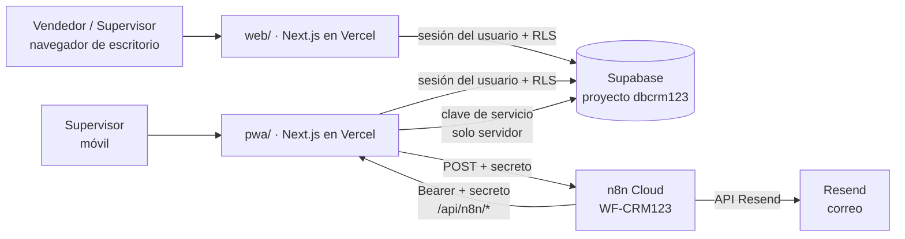

# TECHNICAL_SPEC.md — CRM-123

**Versión 1.0 · 22-nov-2026 · Destinatario: Claude Code Web.**

Especificación técnica de las dos aplicaciones y del flujo de n8n. Se lee junto con `CLAUDE.md` (contrato y seguridad) y `SCRIPTS-SQL.md` (estructura oficial de la base de datos).

> **Jerarquía de documentos.** En datos manda `SCRIPTS-SQL.md`; en seguridad manda `CLAUDE.md`; en todo lo demás, este documento. Esta especificación **no redefine** tablas, columnas, valores ni políticas: las referencia. Si algo aquí contradice a `SCRIPTS-SQL.md`, prevalece `SCRIPTS-SQL.md` y se informa al humano. **Está prohibido modificar la estructura de la base de datos.**

---

## 1. Resumen y alcance

CRM-123 es un CRM minimalista para una librería-cafetería en España (clientes personas, euro, español). Equipo: 10 vendedores y 2 supervisores.

| Aplicación | Carpeta | Usuarios | Propósito |
|---|---|---|---|
| **Sitio web de escritorio** | `web/` | Vendedor y Supervisor | Gestión diaria: clientes, oportunidades, actividades, tablero del día. El supervisor además administra usuarios, reasigna y consulta la auditoría. |
| **PWA del supervisor** | `pwa/` | Solo Supervisor | Consulta rápida en móvil: panel del equipo; interruptor y envío manual del resumen matutino. |
| **Automatización** | `pwa/n8n/WF-CRM123.json` | — | Resumen matutino por correo, vía n8n Cloud y Resend. |

Fuera de alcance (no construir): importaciones masivas, informes exportables, modo offline, notificaciones push, adjuntos, integraciones con otros sistemas, multimoneda, multiidioma, borrado físico.

---

## 2. Arquitectura



Reglas de arquitectura:

1. **Las aplicaciones hablan con Supabase** con la sesión del usuario (la RLS decide) y, solo en el servidor y en operaciones listadas, con la clave de servicio.
2. **n8n nunca toca Postgres.** Todo pasa por los endpoints `/api/n8n/*` de `pwa/`.
3. **Los endpoints `/api/n8n/*` y el disparo manual viven en `pwa/`.** Así la clave de servicio de lectura masiva queda en el mínimo de lugares. `web/` usa la clave de servicio solo para administrar usuarios (sección 8.3).
4. **Dos proyectos de Vercel independientes**, uno por carpeta, con despliegue manual (sección 14).
5. El rol de quien actúa se lee **siempre de `profiles`**, en el servidor (sección 6.2).

---

## 3. Stack aprobado

| Pieza | Elección | Motivo |
|---|---|---|
| Framework | **Next.js** (App Router) con **TypeScript** en modo estricto | Pantallas y servidor en una base; Server Actions y Route Handlers. |
| Estilos y componentes | **Tailwind CSS** + **shadcn/ui** | Minimalista y consistente. |
| Autenticación | **Supabase Auth** (correo + contraseña) con `@supabase/ssr` | Integrada con la RLS. |
| Validación | **Zod** | Valida teléfono, montos y fechas antes de guardar. |
| PWA | Manifiesto + service worker **mínimo escrito a mano** | Solo instalable. Sin dependencias extra. |
| Pruebas | **Vitest** (unitarias) + lista de pruebas manuales por hito | Suficiente para este tamaño. |
| Hospedaje | **Vercel** (despliegue manual) | Definido por el proyecto. |
| Datos | **Supabase** (proyecto `dbcrm123`, UE) | Definido por el proyecto. |
| Automatización / correo | **n8n Cloud** + **Resend** | Definido por el proyecto. |

Versiones: la última estable compatible al iniciar el Hito 2, fijadas por el archivo de bloqueo (`package-lock.json`). Node 20 LTS o superior. No añadir librerías no listadas sin pedir aprobación.

---

## 4. Estructura del repositorio

Rama de producción: **`main`**. Claude Code Web trabaja en una rama de sesión (`claude/…`) y cada hito llega a `main` con un Pull Request que fusiona el humano.

```
/ (raíz)
├── CLAUDE.md
├── TECHNICAL_SPEC.md
├── SCRIPTS-SQL.md
├── BUILD_PLAN.md
├── DESIGN_BRIEF.md
├── .gitignore                 (incluye .env*, excepto .env.example)
├── web/                       Aplicación de escritorio
│   ├── src/app/…              rutas (App Router)
│   ├── src/lib/supabase/      browser.ts · server.ts · admin.ts (server-only)
│   ├── src/lib/…              phone.ts · money.ts · dates.ts · errors.ts
│   ├── src/types/database.ts  tipos GENERADOS desde Supabase (no editar a mano)
│   ├── scripts/check-env.mjs · check-security.mjs
│   ├── .env.example · vercel.json
│   └── package.json
└── pwa/                       PWA del supervisor
    ├── src/app/…              rutas + src/app/api/…
    ├── src/lib/…              mismos módulos + safe-equal.ts · summary/…
    ├── public/                manifest.webmanifest · sw.js · iconos
    ├── n8n/WF-CRM123.json     flujo para importar manualmente en n8n Cloud
    ├── scripts/check-env.mjs · check-security.mjs
    ├── .env.example · vercel.json
    └── package.json
```

`web/` y `pwa/` son aplicaciones independientes; no comparten código por paquete (se duplican los módulos pequeños de `src/lib/`). `vercel.json` de cada una contiene `{"git": {"deploymentEnabled": false}}` (ver sección 14).

---

## 5. Modelo de datos

La estructura es la de `SCRIPTS-SQL.md` (7 tablas: `profiles`, `settings`, `customers`, `opportunities`, `activities`, `audit_log`, `summary_runs`; 4 vistas: `v_next_actions`, `v_pipeline_summary`, `v_team_summary`, `v_lost_reasons_month`). **No se repite aquí.** Los tipos de TypeScript se generan desde Supabase y se guardan en `src/types/database.ts`; nunca se editan a mano.

### 5.1 Reglas de la aplicación sobre los datos

| Tema | Regla |
|---|---|
| **Teléfono** | Se normaliza antes de validar: quitar espacios, puntos, guiones y paréntesis; `00…` → `+…`; 9 dígitos que empiezan por 6, 7, 8 o 9 → anteponer `+34`; si empieza por `+` se conserva. Luego debe cumplir `^\+[1-9][0-9]{7,14}$`. Visualización de números `+34`: `+34 600 111 222`. |
| **Correo** | Minúsculas y recortado. |
| **Dinero** | Siempre euros. Visualización `es-ES`: `1.234,50 €`. Entrada: se aceptan coma o punto decimal; dos decimales. |
| **Fechas** | Visualización `dd/mm/aaaa`. "Hoy" = fecha en la zona de `settings.timezone` (`Europe/Madrid`), obtenida con la función `app_today()` o equivalente en el servidor; nunca la fecha del navegador. |
| **Cerrar oportunidad** | **Ganada**: pedir `final_amount` (propone el estimado) y `closed_on` (hoy por defecto); **limpiar** `next_action_date` y `next_action_text`. **Perdida**: pedir `lost_reason` (lista) y `closed_on`; limpiar la próxima acción. |
| **Reabrir** | Pasar de Ganada/Perdida a una etapa abierta exige **limpiar** `final_amount`, `closed_on` y `lost_reason` en la misma operación. Pueden hacerlo el propietario y el supervisor. |
| **Próxima acción** | Fecha y texto se guardan siempre juntos; para quitarla se ponen ambos en nulo. |
| **Archivar / recuperar** | Se fija o se limpia `archived_at`. Nunca se muestra la palabra "eliminar". Lo hacen el propietario y el supervisor. |
| **Anular actividad** | Se inserta una actividad `anulacion` con `voids_activity_id`. En pantalla la original se muestra tachada con la etiqueta "Anulada". |
| **Reasignar** | Solo el supervisor, actualizando `customers.owner_id` a un **vendedor activo**. La base mueve sus oportunidades y registra la auditoría. |
| **Duplicado de teléfono** | Error `23505` sobre `customers_phone_key`. Mensaje: *"Ese teléfono ya está registrado. Si no lo ves en tu lista, pertenece a otro vendedor: consulta con el supervisor."* (la RLS impide al vendedor ver clientes ajenos; no se revela quién es el propietario). |

### 5.2 Traducción de errores de base de datos

| Código | Situación | Mensaje al usuario (español, sin tecnicismos) |
|---|---|---|
| `23505` | Teléfono o anulación duplicados | Según 5.1 / "Esa actividad ya fue anulada." |
| `23514` | Regla de negocio (límites, cierres, propietario) | El mensaje de la base si es de negocio (por ejemplo "Límite alcanzado: máximo 10 vendedores activos"); si no, "Revisa los datos e inténtalo de nuevo." |
| `42501` | Sin permiso | "No tienes permiso para hacer esto." |
| `23503` / `23001` | Dato relacionado | "No se puede completar: hay datos relacionados." |
| Otros | Imprevisto | "Algo salió mal. Inténtalo de nuevo." y registro del error en el servidor **sin datos personales**. |

---

## 6. Autenticación y sesión

### 6.1 Reglas

1. Ingreso con **correo y contraseña** (Supabase Auth). **El registro público está desactivado**; las cuentas las crea el supervisor.
2. Política de contraseña: mínimo **10 caracteres**, con letras y números (configurar en Supabase Auth y validar también en la aplicación).
3. **Contraseña temporal.** Al crear un usuario o restablecerle la contraseña, el servidor genera una contraseña temporal aleatoria (14 caracteres, `crypto.randomBytes`), la muestra **una sola vez** al supervisor y `profiles.must_change_password` queda en `true`. En el primer ingreso se redirige a "Cambiar contraseña"; al guardarla se llama a la función `mark_password_changed()`.
4. Un usuario con `is_active = false` no puede ingresar ni operar (ver 8.3).
5. Sesión con cookies gestionadas por `@supabase/ssr`. En el servidor se valida con **`supabase.auth.getUser()`**, nunca confiando solo en `getSession()`.
6. Cerrar sesión disponible en todas las pantallas.
7. **Solo supervisores usan la PWA.** Si un vendedor inicia sesión en `pwa/`, se cierra su sesión de inmediato y se muestra: "Esta aplicación es solo para supervisores."

### 6.2 Cómo se obtiene el rol (obligatorio)

Una función de servidor `getCurrentProfile()` hace, con el cliente de servidor (RLS):
`select id, full_name, role, is_active, must_change_password from profiles where id = <id del usuario validado con getUser()>`.

- El rol **solo** se lee de esa consulta. **Nunca** de `user_metadata`, `app_metadata`, claims del JWT, cookies propias, parámetros, cabeceras ni almacenamiento del navegador.
- Se usa en el *middleware* (rutas protegidas, redirecciones por `must_change_password` y por rol) y de nuevo dentro de cada Server Action y Route Handler que requiera un rol (el middleware no es la única barrera).

---

## 7. Acceso a Supabase: tres clientes y sus límites

| Cliente | Archivo | Credencial | Dónde puede usarse |
|---|---|---|---|
| Navegador | `src/lib/supabase/browser.ts` | URL + clave anónima | Componentes de cliente (lecturas simples bajo RLS). |
| Servidor (usuario) | `src/lib/supabase/server.ts` | URL + clave anónima + cookies de sesión | Server Components, Server Actions, Route Handlers. **Es el cliente por defecto.** La RLS aplica. |
| **Administrador** | `src/lib/supabase/admin.ts` | URL + **`SUPABASE_SERVICE_ROLE_KEY`** | **Solo** en las operaciones enumeradas en 8.3 y 9. El archivo empieza con `import 'server-only'`. |

Reglas del cliente administrador (de `CLAUDE.md`): jamás importado desde un componente de cliente, ni siquiera sin usar; nunca exportado en una variable `NEXT_PUBLIC_*`; nunca registrado en logs; cada función que lo use verifica el rol del llamador **antes** de usarlo.

---

## 8. Aplicación web (`web/`)

### 8.1 Rutas

| Ruta | Quién | Contenido (ver `DESIGN_BRIEF.md`) |
|---|---|---|
| `/ingresar` | Público | Inicio de sesión |
| `/cambiar-contrasena` | Autenticado con `must_change_password` | Cambio obligatorio |
| `/` | Ambos | Tablero del día |
| `/clientes`, `/clientes/nuevo`, `/clientes/[id]` | Ambos | Lista, alta y ficha del cliente |
| `/oportunidades`, `/oportunidades/nueva`, `/oportunidades/[id]` | Ambos | Lista, alta y ficha |
| `/archivados` | Ambos | Clientes y oportunidades archivados |
| `/admin/usuarios` | Supervisor | Alta, desactivación, contraseña temporal |
| `/admin/reasignar` | Supervisor | Reasignación individual y en bloque |
| `/admin/auditoria` | Supervisor | Lista de solo lectura de `audit_log` |

Rutas `/admin/*` devuelven "No tienes permiso" a un vendedor (verificación en servidor).

### 8.2 Operaciones (Server Actions) — todas con el cliente de servidor (RLS) salvo indicación

| Operación | Quién | Tablas / vistas |
|---|---|---|
| Listar y buscar clientes (por nombre o teléfono; filtro de archivados) | Ambos | `customers` |
| Crear / editar cliente | Ambos | `customers` (vendedor: `owner_id` = él mismo; supervisor elige un vendedor) |
| Archivar / recuperar cliente | Ambos | `customers.archived_at` |
| Listar / crear / editar oportunidad | Ambos | `opportunities` |
| Cambiar etapa; cerrar Ganada o Perdida; reabrir | Ambos | `opportunities` (reglas de 5.1) |
| Definir o quitar próxima acción | Ambos | `opportunities.next_action_*` |
| Archivar / recuperar oportunidad | Ambos | `opportunities.archived_at` |
| Registrar actividad (llamada, mensaje, reunión o visita, nota) | Ambos | `activities` (insertar) |
| Anular actividad | Ambos (el vendedor solo las suyas) | `activities` (insertar `anulacion`) |
| Tablero del día | Ambos | `v_next_actions` (`next_action_date <= hoy`), `v_pipeline_summary` |
| Cambiar contraseña propia | Todos | Supabase Auth + `rpc('mark_password_changed')` |
| Reasignar (uno o en bloque) | Supervisor | `customers.owner_id` |
| Ver auditoría | Supervisor | `audit_log` (solo lectura, paginada) |
| Crear usuario, desactivar/reactivar, restablecer contraseña temporal | Supervisor | **Cliente administrador** (8.3) |

Todas las listas se paginan (50 por página), seleccionan solo las columnas que muestran (nunca `select *` sobre tablas) y ordenan de forma determinista.

### 8.3 Administración de usuarios (única función de `web/` con clave de servicio)

Cada acción: (1) valida sesión con `getUser()`; (2) `getCurrentProfile()` debe devolver `role = 'supervisor'` y `is_active`; (3) valida con Zod; (4) recién entonces usa el cliente administrador.

- **Crear usuario** (`full_name`, `email`, `role`): `auth.admin.createUser({ email, password: <temporal>, email_confirm: true })` → insertar la fila en `profiles` (`id` del usuario creado, `must_change_password = true`) con el cliente administrador. Si el `INSERT` falla (por ejemplo por los límites de 10 vendedores y 2 supervisores), se **compensa** eliminando el usuario recién creado de Auth para no dejar cuentas huérfanas. Esta compensación técnica es la **única** eliminación permitida en todo el código y no es visible para el usuario.
- **Desactivar**: `profiles.is_active = false` (cliente de usuario, RLS) y luego `auth.admin.updateUserById(id, { ban_duration: '876000h' })`. **Reactivar**: `is_active = true` y `ban_duration: 'none'`. Un supervisor no puede desactivarse a sí mismo (la base además impide dejar el sistema sin supervisor activo).
- **Restablecer contraseña temporal**: `auth.admin.updateUserById(id, { password: <temporal> })` y `must_change_password = true`; se muestra una vez.
- Cada acción deja rastro en `audit_log` (la base registra altas y cambios de estado; el servidor no escribe `audit_log` por su cuenta salvo lo indicado en la sección 10).

---

## 9. PWA del supervisor (`pwa/`)

### 9.1 Rutas

| Ruta | Contenido |
|---|---|
| `/ingresar`, `/cambiar-contrasena` | Igual que en `web/` (solo supervisores) |
| `/` | Panel del equipo |
| `/oportunidades`, `/oportunidades/[id]` | Lista y detalle en modo consulta |
| `/vendedores/[id]` | Detalle de un vendedor (embudo y acciones atrasadas) |
| `/resumen` | Interruptor, "Enviar ahora", último envío |
| `/offline` | Pantalla de falta de conexión |

Datos del panel: `v_team_summary`, `v_pipeline_summary`, `v_lost_reasons_month`, `v_next_actions`, `opportunities` (lectura), todo con la sesión del supervisor (RLS).

### 9.2 Server Actions de la PWA

| Operación | Detalle |
|---|---|
| Activar / desactivar resumen matutino | `update settings set morning_summary_enabled = :valor where id = 1` con el cliente de usuario (RLS: solo supervisor). La base registra `ajuste_actualizado`. |

### 9.3 Instalación y service worker

- `public/manifest.webmanifest`: nombre "CRM-123", `short_name` "CRM-123", `display: standalone`, `start_url: /`, `lang: es`, colores de la marca, iconos 192 y 512 (más versión *maskable*).
- `public/sw.js` mínimo: precachea solo `/offline` y los iconos; para navegaciones, intenta red y, si falla, muestra `/offline`. **Nunca** cachea `/api/*`, respuestas de Supabase ni páginas con datos.
- Sin notificaciones push. Sin sincronización en segundo plano.

---

## 10. Resumen matutino: contrato completo

### 10.1 Piezas y responsabilidades

| Pieza | Responsabilidad |
|---|---|
| `pwa/` (Route Handlers) | Decide **quién** recibe, calcula el contenido, genera asunto y HTML de cada correo, lleva el registro (`summary_runs`) y la auditoría. |
| n8n `WF-CRM123` | Planifica (lunes a viernes 7:30, Europe/Madrid), pide el contenido, envía cada correo por Resend con pausas, informa el resultado. **No contiene lógica de negocio.** |
| Resend | Entrega el correo. La clave de Resend vive **solo** en las credenciales de n8n. |

### 10.2 Quién recibe qué

- Cada **vendedor activo** recibe su resumen personal.
- Cada **supervisor activo** recibe el resumen del equipo.
- Máximo 12 destinatarios por ejecución.

### 10.3 Contenido de los correos (calculado por la aplicación)

**Vendedor** — asunto: `CRM-123 · Tu resumen del <día de la semana> dd/mm/aaaa`.
1. Saludo: "Buenos días, <nombre>".
2. **Acciones de hoy**: por cada una, cliente, teléfono, oportunidad (título) y texto de la acción.
3. **Acciones atrasadas**: igual, con los días de atraso.
4. **Tus oportunidades abiertas**: tabla por etapa (cantidad y monto estimado en €) y total.
5. Si no hay acciones: "Sin acciones pendientes".
6. Pie: "Mensaje automático de CRM-123."

**Supervisor** — asunto: `CRM-123 · Resumen del equipo del dd/mm/aaaa`. Tabla por vendedor (de `v_team_summary`): abiertas, monto abierto, ganadas del mes y su monto, perdidas del mes, acciones atrasadas; fila de totales; y los motivos de pérdida del mes (de `v_lost_reasons_month`).

Reglas de generación: todo texto de usuario (nombres, títulos, acciones) se **escapa para HTML**; importes con formato `es-ES`; cada correo incluye también versión de texto plano; sin imágenes externas.

### 10.4 Modo de prueba (remitente `onboarding@resend.dev`)

Resend solo entrega desde `onboarding@resend.dev` a la dirección de la cuenta de Resend del propietario. Por eso:

- `RESEND_FROM` contiene el remitente completo: `CRM-123 <onboarding@resend.dev>`.
- Si `SUMMARY_TEST_RECIPIENT` tiene valor, la aplicación pone **ese** correo como destino de **todos** los mensajes y antepone al asunto `[PRUEBA para <correo real>] `.
- Para pasar a producción: verificar un dominio propio en Resend, cambiar `RESEND_FROM` a una dirección de ese dominio y **vaciar** `SUMMARY_TEST_RECIPIENT`. No requiere cambios de código.

### 10.5 Endpoints de `pwa/`

| Método y ruta | Quién | Función |
|---|---|---|
| `POST /api/summary/send` | Supervisor (sesión) | Disparo manual (sección 11). |
| `POST /api/n8n/runs/start` | n8n (Bearer) | Inicia una ejecución automática. |
| `GET /api/n8n/runs/{id}/payload` | n8n (Bearer) | Entrega destinatarios y contenido. |
| `POST /api/n8n/runs/{id}/finish` | n8n (Bearer) | Cierra la ejecución con el resultado. |

Todos los endpoints `/api/n8n/*`: método fijo, `Authorization: Bearer <N8N_API_SECRET>` comparado con `safeEqual` (sección 12), respuesta `401` genérica si falla, `Cache-Control: no-store`, cuerpo JSON validado con Zod, **sin** cookies ni sesión de usuario.

**`POST /api/n8n/runs/start`** — cuerpo `{ "trigger": "automatico" }`.
1. Marca como `fallido` ("Tiempo de espera agotado") cualquier ejecución `en_curso` con más de 30 minutos.
2. Si `settings.morning_summary_enabled = false` → `200 { "skip": true, "reason": "interruptor_desactivado" }`.
3. Si ya existe una ejecución `automatico` terminada hoy (zona `Europe/Madrid`) → `200 { "skip": true, "reason": "ya_enviado_hoy" }`.
4. Si hay una `en_curso` → `200 { "skip": true, "reason": "ya_en_curso" }`.
5. Si no, crea la fila en `summary_runs` (`automatico`, `en_curso`) → `200 { "skip": false, "run_id": "<uuid>" }`.

**`GET /api/n8n/runs/{id}/payload`** — exige que la ejecución exista, esté `en_curso` y haya empezado hace menos de 30 minutos (si no, `409`). Calcula los destinatarios y contenido con el cliente administrador **filtrando explícitamente por propietario** (la clave de servicio ignora la RLS), actualiza `recipients_total` y responde:

```json
{
  "run_id": "uuid",
  "from": "CRM-123 <onboarding@resend.dev>",
  "test_mode": true,
  "recipients": [
    { "to": "destino@dominio", "kind": "vendedor", "subject": "…", "html": "…", "text": "…" }
  ]
}
```

**`POST /api/n8n/runs/{id}/finish`** — cuerpo `{ "sent": 0, "failed": 0, "errors": [ { "to": "…", "message": "…" } ] }` (máx. 12 errores, mensajes recortados a 200 caracteres). Solo si la ejecución está `en_curso` (si no, `409`: no se puede cerrar dos veces). Estado final: `failed = 0` → `correcto`; `sent > 0` y `failed > 0` → `con_errores`; `sent = 0` → `fallido`. Guarda `recipients_sent`, `error_detail` y `finished_at`, e inserta en `audit_log` la acción `resumen_finalizado` (entidad `summary_run`, sin actor).

### 10.6 Flujo n8n `WF-CRM123` (para generar en el Hito 4)

Archivo: `pwa/n8n/WF-CRM123.json`, importable manualmente en n8n Cloud. Zona horaria del flujo: `Europe/Madrid`. **No usa variables personalizadas de n8n** (requieren plan Pro): la URL base se escribe en un único nodo de configuración.

| # | Nodo | Configuración |
|---|---|---|
| 1 | **Schedule Trigger** "Lunes a viernes 7:30" | Cron `30 7 * * 1-5`. |
| 2 | **Webhook** "Disparo manual" | `POST`, ruta `crm123-resumen-manual`, autenticación *Header Auth* (cabecera `X-CRM-Secret`, credencial "CRM123 Webhook Secret"), respuesta inmediata `200`. Cuerpo esperado: `{ "run_id": "<uuid>" }`. |
| 3 | **Edit Fields** "Origen automático" / "Origen manual" | Fijan `origen` (`automatico` o `manual`) y, en el manual, `run_id` desde el cuerpo. |
| 4 | **Edit Fields** "Config" | Único lugar con `app_base_url` (URL de producción de la PWA, a editar tras importar). |
| 5 | **IF** "¿Es automático?" | Rama automática → nodo 6. Rama manual → nodo 8. |
| 6 | **HTTP Request** "Iniciar ejecución" | `POST {app_base_url}/api/n8n/runs/start`, cuerpo `{"trigger":"automatico"}`, credencial *Header Auth* `Authorization: Bearer …` ("CRM123 API Secret"). |
| 7 | **IF** "¿Omitir?" | Si `skip = true` → **No Operation** y fin. Si no → nodo 8 con `run_id`. |
| 8 | **HTTP Request** "Obtener contenido" | `GET {app_base_url}/api/n8n/runs/{run_id}/payload` (misma credencial). Error → nodo 13. |
| 9 | **Split Out** | Separa `recipients`. |
| 10 | **Loop Over Items** | Lote de 1. |
| 11 | **HTTP Request** "Enviar con Resend" | `POST https://api.resend.com/emails`, credencial "Resend API" (Bearer), cuerpo `{ from, to, subject, html, text }` tomados del contenido. *On Error: continue*. |
| 12 | **Wait** | 1 segundo entre envíos (límite de Resend). Tras el bucle, **Code** cuenta `sent`, `failed` y arma `errors`. |
| 13 | **HTTP Request** "Informar resultado" | `POST {app_base_url}/api/n8n/runs/{run_id}/finish` con `sent`, `failed`, `errors`. Si falló el nodo 8: `sent = 0`, `failed = 0`, `errors = [{"to":"-","message":"No se pudo obtener el contenido"}]`. |

Ningún nodo contiene claves en claro: todas van en **credenciales** de n8n.

---

## 11. Disparo manual: protección paso a paso

`POST /api/summary/send` (en `pwa/`), invocado por el botón "Enviar ahora". Cada paso falla de forma segura y devuelve un mensaje genérico (nunca detalla secretos ni rutas internas).

1. **Solo `POST`**, cuerpo JSON `{ "confirm_recipients": <número> }`, `Content-Type: application/json`.
2. **Comprobación de origen (anti-CSRF):** la cabecera `Origin` debe ser exactamente `APP_ORIGIN`. Si no, `403`. Las cookies de sesión van con `SameSite=Lax` y `Secure`.
3. **Sesión válida:** `getUser()`; si no hay usuario, `401`.
4. **Rol desde `profiles`:** `getCurrentProfile()` debe dar `role = 'supervisor'` e `is_active`. Si no, `403`. (No se usa JWT ni nada del cliente.)
5. **Configuración mínima presente:** si faltan `N8N_WEBHOOK_URL` o `N8N_WEBHOOK_SECRET`, `500` genérico y aviso en los logs del servidor (sin valores).
6. **Intervalo mínimo:** se consulta la última ejecución `manual`; si empezó hace menos de `settings.manual_send_min_interval_minutes` (10), `429` con "Espera unos minutos antes de volver a enviar".
7. **Sin ejecuciones simultáneas:** se marcan `fallido` las `en_curso` de más de 30 minutos; si queda alguna `en_curso`, `409`. (La base lo garantiza con el índice único `summary_runs_single_running`.)
8. **Confirmación explícita:** el servidor recalcula el número de destinatarios; si no coincide con `confirm_recipients` (el que el supervisor vio en pantalla: "Se enviará a N personas"), `409` y se pide reconfirmar.
9. **Registro previo:** con el cliente administrador, `INSERT` en `summary_runs` (`manual`, `en_curso`, `requested_by` = supervisor) e `INSERT` en `audit_log` (`resumen_manual_solicitado`, entidad `summary_run`, `actor_id` = supervisor).
10. **Llamada a n8n:** `POST N8N_WEBHOOK_URL` con la cabecera `X-CRM-Secret: <N8N_WEBHOOK_SECRET>`, cuerpo `{ "run_id": "<uuid>" }`, **tiempo máximo 10 s**, sin redirecciones. No se envían datos de clientes. Si falla (red, `4xx`, `5xx`), la ejecución se marca `fallido` con un detalle genérico y se responde `502`.
11. **Respuesta `202`** con `{ "run_id": "<uuid>" }`. La pantalla consulta el estado de `summary_runs` (cada 3 segundos hasta que deje de estar `en_curso`) y muestra "En ejecución", "Correcto", "Con errores" o "Fallido".
12. **Después**, n8n se autentica en `/api/n8n/*` con un secreto **distinto** (`N8N_API_SECRET`). Cada ejecución solo se puede leer y cerrar mientras esté `en_curso`; no admite repeticiones.

Rotación de secretos: si alguno se filtra, se genera uno nuevo, se actualiza en Vercel **y** en la credencial de n8n, y se vuelve a desplegar manualmente. Nunca se pega un secreto en una conversación.

---

## 12. Comparación segura de secretos

Todo secreto (`N8N_API_SECRET`, `N8N_WEBHOOK_SECRET` si se verificara en la aplicación) se compara con **`crypto.timingSafeEqual`**, nunca con `===`, `==` ni `Buffer.compare`. Como `timingSafeEqual` exige longitudes iguales, el módulo `src/lib/safe-equal.ts` aplica primero SHA-256 a ambos valores y compara los digestos:

```ts
import { createHash, timingSafeEqual } from 'node:crypto';
const digest = (v: string) => createHash('sha256').update(v, 'utf8').digest();
export function safeEqual(received: string | null | undefined, expected: string | undefined): boolean {
  if (!received || !expected) return false;
  return timingSafeEqual(digest(received), digest(expected));
}
```

Generación de secretos: al menos 32 bytes aleatorios, por ejemplo `node -e "console.log(require('crypto').randomBytes(48).toString('base64url'))"`. Los dos secretos (`N8N_WEBHOOK_SECRET`, `N8N_API_SECRET`) deben ser valores **diferentes**.

---

## 13. Variables de entorno

Los valores reales **nunca** se guardan en GitHub. Cada aplicación tiene un `.env.example` (solo nombres) y un script `scripts/check-env.mjs` que informa, **sin imprimir valores**, qué variables están presentes y cuáles faltan.

### 13.1 `web/` (proyecto de Vercel "CRM-123 web")

| Variable | Pública | Origen del valor |
|---|---|---|
| `NEXT_PUBLIC_SUPABASE_URL` | Sí | Supabase › proyecto `dbcrm123` › Project Settings › API (URL del proyecto). |
| `NEXT_PUBLIC_SUPABASE_ANON_KEY` | Sí | Supabase › Project Settings › API Keys › clave **anon / publishable**. |
| `SUPABASE_SERVICE_ROLE_KEY` | **No (secreta)** | Supabase › Project Settings › API Keys › clave **service_role / secret**. Solo servidor. Marcar como *Sensitive* en Vercel. |

### 13.2 `pwa/` (proyecto de Vercel "CRM-123 pwa")

| Variable | Pública | Origen del valor |
|---|---|---|
| `NEXT_PUBLIC_SUPABASE_URL` | Sí | Igual que arriba. |
| `NEXT_PUBLIC_SUPABASE_ANON_KEY` | Sí | Igual que arriba. |
| `SUPABASE_SERVICE_ROLE_KEY` | **No** | Igual que arriba. |
| `APP_ORIGIN` | No | URL de producción de la PWA, sin barra final (por ejemplo `https://crm-123-pwa.vercel.app`). Vercel › proyecto › Domains. |
| `N8N_WEBHOOK_URL` | No | URL de producción del nodo Webhook de `WF-CRM123` en n8n Cloud (se obtiene al importar y activar el flujo). |
| `N8N_WEBHOOK_SECRET` | **No (secreta)** | La genera el humano (sección 12). El mismo valor va en la credencial "CRM123 Webhook Secret" de n8n. |
| `N8N_API_SECRET` | **No (secreta)** | La genera el humano (sección 12), distinta de la anterior. El mismo valor va en la credencial "CRM123 API Secret" de n8n (`Authorization: Bearer …`). |
| `RESEND_FROM` | No | `CRM-123 <onboarding@resend.dev>` (más adelante, una dirección de un dominio verificado). |
| `SUMMARY_TEST_RECIPIENT` | No | Correo de la cuenta de Resend (modo prueba). Vacío en producción con dominio verificado. |

### 13.3 En n8n Cloud (credenciales, no variables)

| Credencial | Tipo | Contenido |
|---|---|---|
| "CRM123 Webhook Secret" | Header Auth | Nombre `X-CRM-Secret`, valor = `N8N_WEBHOOK_SECRET`. |
| "CRM123 API Secret" | Header Auth | Nombre `Authorization`, valor `Bearer <N8N_API_SECRET>`. |
| "Resend API" | Header Auth | Nombre `Authorization`, valor `Bearer <clave de API de Resend>` (Resend › API Keys, permiso de envío). |

### 13.4 Reglas
- Prefijo `NEXT_PUBLIC_` **solo** para la URL y la clave anónima.
- `SUPABASE_SERVICE_ROLE_KEY` jamás con prefijo `NEXT_PUBLIC_`, jamás en un componente de cliente, jamás en logs.
- Sin valores por defecto inventados en el código: si falta una variable obligatoria, el servidor falla con un mensaje claro que nombra la variable (no su valor).

---

## 14. Despliegue (manual)

- GitHub guarda el código; la rama de producción es `main`. Dos proyectos de Vercel conectados al repositorio, con *Root Directory* `web` y `pwa` respectivamente.
- Para que **ningún** push despliegue solo, cada carpeta lleva `vercel.json` con `{"git": {"deploymentEnabled": false}}`.
- Cada despliegue lo inicia el humano con el **Deploy Hook** de su proyecto (Vercel › Settings › Git › Deploy Hooks, rama `main`), que acepta una petición HTTP. Claude Code Web **nunca** despliega.
- En el Hito 2 se **verifica** que el Deploy Hook funciona con `deploymentEnabled: false`. Si Vercel lo bloqueara, se informa al humano y se acuerda una alternativa antes de continuar.

---

## 15. Seguridad transversal (resumen; el detalle obligatorio está en `CLAUDE.md`)

- Cabeceras en ambas aplicaciones: `X-Frame-Options: DENY`, `X-Content-Type-Options: nosniff`, `Referrer-Policy: strict-origin-when-cross-origin`, `X-Robots-Tag: noindex`, y una `Content-Security-Policy` que solo permita el origen propio y el dominio del proyecto de Supabase.
- Ninguna ruta de API devuelve trazas ni mensajes internos.
- Los logs del servidor no contienen teléfonos, correos ni contenido de notas: solo identificadores y códigos de error.
- Cookies de sesión con `HttpOnly`, `Secure`, `SameSite=Lax` (valores por defecto de `@supabase/ssr` en producción).
- `scripts/check-security.mjs` (obligatorio en cada aplicación; ver `CLAUDE.md`) se ejecuta antes de cada confirmación de hito.

---

## 16. Pruebas

**Unitarias (Vitest), obligatorias:** normalización y validación de teléfono; formato de euros y fechas; `safeEqual`; escape de HTML y generación de los correos del resumen; construcción de las operaciones de cierre y reapertura de oportunidades (campos que se fijan y se limpian); traducción de errores de base de datos.

**Manuales:** cada hito de `BUILD_PLAN.md` trae su lista de pruebas de funcionalidad con resultado esperado.

---

## 17. Supuestos por defecto (a confirmar)

Decisiones de bajo riesgo tomadas durante el diseño. El humano puede cambiarlas antes del Hito 2.

1. La oportunidad tiene un **título** obligatorio y notas opcionales; el cliente tiene notas opcionales.
2. El **envío manual ignora el interruptor** "Resumen matutino activo": es una acción deliberada del supervisor. El interruptor solo gobierna el envío automático.
3. Vendedor y supervisor pueden **archivar y recuperar** sus clientes y oportunidades visibles.
4. Pueden **reabrir** una oportunidad cerrada el propietario y el supervisor.
5. El supervisor dispone de una pantalla de **auditoría** de solo lectura en `web/`.
6. La contraseña temporal la **genera el servidor**; el supervisor la comunica a la persona.
7. El envío automático **no distingue festivos**: solo lunes a viernes.

## 18. Riesgos y limitaciones conocidos

| Riesgo | Mitigación |
|---|---|
| `onboarding@resend.dev` solo entrega a la cuenta propietaria de Resend. | Modo de prueba (10.4); verificar dominio propio antes de usar con el equipo real. |
| El plan gratuito de Supabase **pausa** el proyecto tras una semana de baja actividad. | El uso diario y el envío de las 7:30 generan actividad; si se pausa, se reanuda desde el panel de Supabase. Para el equipo real se recomienda el plan de pago. |
| Las variables personalizadas de n8n Cloud requieren plan Pro. | El flujo no las usa. |
| Hasta el Hito 4 no existe la pantalla de usuarios. | Los usuarios de prueba se crean con la plantilla `07_bootstrap_profiles_TEMPLATE.sql`. |
